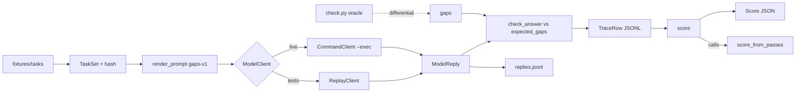

# E1 evalbench: frozen task set, checker, trace schema, first-pass score

## 1. Goal
Build evalbench E1 in Rust so the failing tests and frozen fixtures turn green. Deliver a hashed synthetic task set, a Python-parity gap checker, trace schema v1, a deterministic first-pass score, and a CLI. Sources: the product plan (IMPLEMENTATION-PLAN.md, E1 row in section 4), the Claude review of it, the 29 Oct rust brief (score formula superseded).

## 2. Base
- Branch `master`, SHA `74be50b04f2028a583ff5d74a63c0844b574d060`.
- Builder works on a new branch (for example `e1-evalbench`) off that SHA, Claude's test commit on top.
- Claude's tests, fixtures and stubs are uncommitted in this worktree (plus `Cargo.toml`, `Cargo.lock`, `.gitattributes`). Step 0: commit them as-is: `test: E1 evalbench failing tests and frozen fixtures`.

## 3. Design



- Python reference `check.py` is the differential oracle for `gaps()`.
- Proofs cover only the integer parts: `percent_floor`, `score_from_passes`, `gaps_from_flags`.
- `score()` MUST call `score_from_passes` so the proofs cover shipped code.

## 4. Crate layout
```text
Cargo.toml  .gitattributes                 (workspace members added; fixtures -text)
crates/evalbench-core/
  Cargo.toml                               (feature broken-proof-check)
  src/ lib.rs check.rs taskset.rs trace.rs answer.rs score.rs runner.rs proofs.rs
  tests/ check_port.rs task_set.rs trace.rs answer.rs score.rs runner.rs
         differential.rs kani_gate.rs common/mod.rs reference/check.py
  fixtures/ tasks/ (12 dirs) parity/ (p01..p06) prompts/gaps-v1.txt
            replay/{replies,traces}.jsonl score.json   tasks.sha256
crates/evalbench-cli/
  Cargo.toml  src/{lib.rs,main.rs}  baselines/README.md
  tests/cli.rs  tests/fixtures/{fake-model.sh,failing-model.sh}
```

## 5. Public API (frozen contract)
The stub files are the contract: `crates/evalbench-core/src/*.rs` and `crates/evalbench-cli/src/lib.rs`. Signatures are frozen and tests call exactly them. The builder must not change signatures, types, tests, fixtures, goldens or `tasks.sha256`. Any such change must be named and justified in the PR, and it blocks review.

## 6. Score definition
Verbatim: "first-pass correctness = tasks passing their frozen checker on the first run, divided by tasks, plus median tokens per passing task".

- `score = floor(100*min(first_pass,tasks)/tasks) as u8`, integer u64 math, 0 when `tasks == 0`.
- `median_tokens_passing` = lower median (`sorted[(n-1)/2]`) of `tokens_in+tokens_out` over passing attempt-1 rows; `None` if none pass. Reported beside, never folded in.

| Case | Result |
|---|---|
| Empty set | score 0, median None, run_id None |
| No traces | 0, missing = tasks |
| No attempt-1 pass | 0 |
| 2/3, 7/12 | 66, 58 |
| Missing attempt-1 row | fail, missing += 1 |
| attempt >= 2 | ignored |
| Duplicate attempt-1 | DuplicateFirstAttempt |
| Wrong hash | WrongTaskSet |
| Unknown task | UnknownTask |
| More than one run_id | MixedRuns (sorted ids; CLI `--run-id` selects) |
| Token add overflow | TokenOverflow |
| Duplicate set id | DuplicateTaskId |
| Row order | irrelevant |

Determinism: pure fn, no maps in `Score`, fixed field order. Re-scoring the same traces gives an identical struct and identical bytes. Live reruns are a reported spread in E5, never the official score.

P2 reconciliation: "empty evidence gives 0" means an empty task set scores 0, and a run with no evidenced (passing) first attempt scores 0. At pack level, an empty evidence list gaps every must-have, so that task cannot pass. The superseded rule "zero must-haves => 100" (D-E3) is now the P2 broken variant.

## 7. Trace schema v1
| Field | Type / rule |
|---|---|
| schema_version | u32 = 1 |
| run_id | `[A-Za-z0-9._-]{1,64}` |
| task_id | `[a-z0-9][a-z0-9-]{0,63}`, in set |
| attempt | u32 >= 1 |
| model_id | non-empty |
| prompt_id | non-empty ("gaps-v1") |
| tokens_in, tokens_out, cost_micro_usd | u64 (floats, negatives, strings rejected) |
| pass | bool, set by the frozen checker only |
| task_set_hash | 64 lowercase hex |

Compact JSON, keys in this order, `\n` terminated, unknown fields denied, blank lines rejected except a single final newline; errors carry the 1-based line. No prompt or response text in traces; replies go to `replies.jsonl` (ModelReply rows: task_id, model_id, text, tokens_in, tokens_out, cost_micro_usd).

## 8. Frozen-set hash method
- Root `crates/evalbench-core/fixtures/tasks/`; each task dir has exactly `expected.json`, `pack.json`, `posting.json`. Anything else is an error naming the path (dotfiles, stray files, missing file, bad id, backslash, non-UTF-8).
- Relative `/` paths sorted bytewise; manifest line `<sha256 hex of raw bytes>  <relpath>\n` (sha256sum format, two spaces); hash = sha256 hex of the manifest.
- `fixtures/tasks.sha256` = `<hex>\n` (65 bytes), a sibling of `tasks/` so it never hashes itself.
- Current hash: `55faad2e303c22039226da1295312218c6f3b51af4d643d00ab5af8364b4b3df` (36 files, 12 tasks).
- Shell cross-check: `(cd crates/evalbench-core/fixtures/tasks && LC_ALL=C find . -type f | sed 's|^\./||' | LC_ALL=C sort | xargs shasum -a 256) | shasum -a 256`
- `.gitattributes` marks the fixtures `-text` so CRLF cannot drift the bytes.
- Prompt `fixtures/prompts/gaps-v1.txt` sha256 `db35a8ff4710d105449cb25302d914fdc59cb2449d68be1aa72d9f10cf5efc40`.
- Vendored `tests/reference/check.py` sha256 `986881450914238a6bfa8a432449a38ea76b6d3eaccbeea6a620ea26db697491` (byte copy of the Python evalbench `check.py`).

## 9. Fixtures
- 12 tasks, `t01-full` ... `t12-no-proof-key`; t01/t02 posting and packs are byte copies of the Python synthetic data.
- 6 parity cases `p01..p06` (differential only, not hashed).
- Every `expected.json` was produced by the Python reference.
- Replay goldens: `replies.jsonl` (12) -> `traces.jsonl` -> `score.json` = tasks 12, first_pass 7, score 58, median_tokens_passing 421, run_id `replay-001`, model `synthetic-replay-model`.
- Wrong answers by design: t06, t07, t11, t12; t08 is code-fenced, which fails the strict parse.

## 10. Test plan
| File | Tests | Asserts |
|---|---|---|
| core/tests/check_port.rs | 15 | gaps parity rules: same-item proof+keyword, empty proof, whitespace proof, case-insensitive substring, empty keyword, empty list, zero must-haves, Unicode, order+duplicates, flags->gaps, parse error |
| core/tests/task_set.rs | 8 | frozen hash = committed file, manifest format/sort, byte/rename sensitivity, order independence, stray/missing/bad id rejects, expected mismatch, 12 sorted tasks, `fixtures_are_synthetic` |
| core/tests/trace.rs | 4 | byte-exact round trip, bad-row rejects, line numbers, blank lines |
| core/tests/answer.rs | 4 | exact gap-set pass, unparseable fails, `prompt_template_is_frozen`, prompt inserts raw files once |
| core/tests/score.rs | 9 | floor percent, missing=fail, retries ignored, lower median, empty set, no pass, re-score identical, error variants, JSON field order |
| core/tests/runner.rs | 7 | replay = golden traces, token/cost/model copy, client error names task, wrong-task reply, bad run id, duplicate replay task, end-to-end golden score |
| core/tests/differential.rs | 2 | `reference_check_py_is_byte_identical_to_source`; Rust gaps = `python3 -I` on every task and parity fixture |
| core/src/proofs.rs | 2 | P1/P2 bounded exhaustive (see below) |
| core/tests/kani_gate.rs | 1 (ignored) | Kani gate |
| cli/tests/cli.rs | 13 | hash/--verify exit codes, check exit codes + Python parity, score golden bytes twice, MixedRuns, record, run --replay, refuse existing --out, --exec offline, --exec failure |

Current state, verified by Claude on laptop-1: `cargo test --locked -p evalbench-core -p evalbench-cli --no-fail-fast` gives 61 failed, 3 passed, 1 ignored.
- All failures are `E1:` stub panics; in the CLI tests these show as exit 101 from the stub binary.
- The 3 passes are guards: `reference_check_py_is_byte_identical_to_source`, `prompt_template_is_frozen`, `fixtures_are_synthetic`. The 1 ignored is the Kani gate.
- Existing crates' tests are unchanged and green.

Proof tests `p1_score_in_range_and_broken_variant_is_caught` and `p2_no_pass_scores_zero_and_broken_variant_is_caught` each first assert that the checker finds a counterexample in the broken variant (P1 prints `Some((2, 1, "200"))`; P2 prints `Some(([], "100"))`), then assert the real fn holds. Today they fail on the real fn's stub.

## 11. Kani
- cargo-kani is NOT installed on laptop-1.
- Harnesses are `#[cfg(kani)]` in `src/proofs.rs`; the broken harnesses also need `--features broken-proof-check`.
- `tests/kani_gate.rs` is `#[ignore]` and, when run, fails loudly with "cargo-kani not installed: P1/P2 Kani proofs NOT RUN".
- Bounded exhaustive tests in normal `cargo test` carry P1/P2 until Kani is installed (the operator's call).
- A Kani CI job needs `.github/workflows`, a risky path that needs the operator's yes.

## 12. Build order
Each step turns the named test file green.

| # | Step | Green |
|---|---|---|
| 0 | Commit tests/fixtures/stubs as-is | n/a |
| 1 | `check.rs` | check_port.rs, differential.rs |
| 2 | `taskset.rs` | task_set.rs |
| 3 | `trace.rs` + `answer.rs` | trace.rs, answer.rs |
| 4 | `score.rs` (calls `score_from_passes`) | score.rs, proofs |
| 5 | `runner.rs` | runner.rs |
| 6 | CLI (below) | cli.rs |
| 7 | Add an evalbench row + commands to `docs/MAP.md` | n/a |

CLI (`main.rs`, clap; exit 0 ok / 1 finding / 2 error):
- `hash <dir> [--verify <file>]`
- `check <posting> <pack>`
- `score --tasks <dir> [--run-id ID] <traces>`
- `record --tasks --out --run-id --task-id --attempt --model-id --tokens-in --tokens-out --cost-micro-usd --answer`: no `--pass`; pass is computed by `check_answer`; duplicate (run, task, attempt) exits 2.
- `run --tasks --run-id --out (--replay <replies> | --exec PROG [--arg ..] [--timeout-secs N] [--replies-out F])`: refuses an existing `--out`.
- `CommandClient`: prompt on stdin, env `EVALBENCH_TASK_ID`, stdout one `ModelReply` JSON; non-zero exit -> `ClientError` naming the task.

## 13. Decisions (correctable)
| ID | Decision |
|---|---|
| D1 | score uses floor |
| D2 | empty keyword matches any proved claim (Python parity, flagged) |
| D3 | zero must-haves -> no gaps |
| D4 | lower median |
| D5 | Unicode `to_lowercase` |
| D6 | proof = Some(non-empty), no trim |
| D7 | strict answer format |
| D8 | missing attempt-1 = fail |
| D9 | extra `prompt_id` field |
| D10 | one run per score, no spread field |
| D11 | client error stops the run |
| D12 | live calls only via `--exec`; no HTTP or keys in evalbench |
| D13 | Kani gate `#[ignore]` |
| D14 | python3 missing = loud failure |
| D15 | strict hash layout |
| D16 | pass judged by the checker, never asserted by the harness |

## 14. Acceptance checks
```sh
cargo fmt --all --check
cargo clippy --locked --workspace --all-targets -- -D warnings
cargo test --locked --workspace
cargo test -p evalbench-core proofs -- --nocapture
cargo test -p evalbench-core --test differential
cargo run -q -p evalbench-cli -- hash crates/evalbench-core/fixtures/tasks --verify crates/evalbench-core/fixtures/tasks.sha256
(cd crates/evalbench-core/fixtures/tasks && LC_ALL=C find . -type f | sed 's|^\./||' | LC_ALL=C sort | xargs shasum -a 256) | shasum -a 256   # must equal tasks.sha256
for i in 1 2; do cargo run -q -p evalbench-cli -- score --tasks crates/evalbench-core/fixtures/tasks crates/evalbench-core/fixtures/replay/traces.jsonl; done | uniq | wc -l   # expect 1
cargo test -p evalbench-core --test kani_gate -- --ignored   # today: fails with "cargo-kani not installed"
cargo test -p ensembly-kernel && cargo test -p ensembly-memory && cargo build -p ensembly-agents --bin ensembly-mcp
```
Note: with the local toolchain 1.90 on laptop-1, workspace clippy already fails on HEAD in `crates/ensembly-kernel/src/company_audit.rs:713` (`clippy::const_is_empty`). This predates the change, and the evalbench crates are clippy-clean. CI pins 1.99.1; the builder reports what CI shows and does not edit kernel code for it.

## 15. Baseline live run
After the operator's yes on model id, wrapper and cost cap. Results go to `crates/evalbench-cli/baselines/<run_id>/{traces.jsonl,replies.jsonl,score.json,run.md}`, with SHA, command, date and n. Add a test that committed baselines re-score identically. Not part of merge-readiness for the code PR.

## 16. Out of scope
HTTP clients and API keys; Kani CI job; spread and treatment run (E5); `private_scan` port; pulse; `cargo install --git` and publishing; monotonicity and order proofs; cost totals in `Score`; edits to `AGENTS.md`, `.github/workflows`, existing crates, `.gitignore`, `prototype/`.

## 17. Risks
| Risk | Mitigation |
|---|---|
| Wrong goldens | cross-checked with `python3 -I` and the shell pipeline |
| CI red until build lands | tests and build in one PR; never merge red |
| ubuntu python3 | D14: missing = loud failure |
| Kani unproven | bounded exhaustive tests; operator decides install |
| CRLF drift | `.gitattributes` `-text` |
| t06 trap and strict format lower the baseline | intended |
| Baseline cost | operator's yes first |

## 18. Grok plan check
Grok must read this file and the stubs, and list questions or disagreements before building.

## 19. PR body draft
Builder writes the PR body to its own fresh `mktemp` file. Push and PR create need the operator's confirmation. Never merge, force-push or delete without the operator's explicit yes. Merge review is by Claude (cross-family).

```md
## What
evalbench E1: frozen synthetic task set, Python-parity gap checker, trace schema v1, first-pass score, CLI.

## Why
A deterministic, replayable baseline: tasks passing the frozen checker first time, median tokens beside.

## Changes
- core: check, taskset, trace, answer, score, runner
- proofs: P1/P2 bounded tests with broken variants
- cli: hash, check, score, record, run
- docs/MAP.md row

## Checks
fmt, clippy, workspace tests, proofs, differential, hash cross-check, double-score.

## Risk
Kani not run (not installed). New crates only; no kernel edits.

## Evidence
- tests: <counts>
- proofs --nocapture: <P1 and P2 counterexamples>
- hash cross-check: <equal?>
- double-score uniq: <1>
- kani_gate: <output>

🤖 Generated with [Claude Code](https://claude.com/claude-code)
```

## 20. Run
`cursor-agent -p --model grok-4.7 "Read .handoff/20261113-1344-e1-evalbench.md and AGENTS.md. Do the plan check first, then implement in order. Do not edit tests, fixtures, goldens or tasks.sha256. Do not push."`
