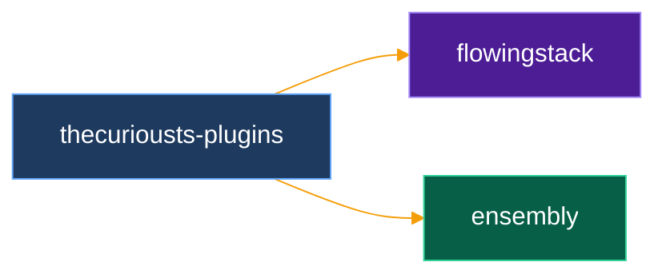

# ensembly

Thin operator kernel under capture harnesses — not a second chat OS.

Bots and harnesses **propose**. ensembly **authorizes, claims, and completes**. Pulse-pack syncs memory. One SQLite writer owns the ledger.

| | |
|--|--|
| **Law** | [PRODUCT-CHARTER.md](docs/PRODUCT-CHARTER.md) · [AGENTS.md](AGENTS.md) |
| **Map** | [docs/MAP.md](docs/MAP.md) · [GLOSSARY.md](docs/GLOSSARY.md) |
| **Cut** | [Musk algorithm](docs/MUSK-CUT-2026-09-04.md) — question, delete, simplify, accelerate, automate |
| **Score** | [docs/scoreboard.md](docs/scoreboard.md) — public CI first-pass, merges, open-to-merge time |
| **Essays** | [captain.kingsparrow.space/articles](https://captain.kingsparrow.space/articles) |

## Quickstart

**New to the terminal?** Follow [docs/START-HERE.md](docs/START-HERE.md): numbered steps for macOS, Linux and Windows, what to install first, what success looks like, and what to do when a step fails.

Prereqs: `git` and `cargo` on `PATH` (the installer tells you how to get them; it never installs toolchains or uses `sudo`). The first `cargo build` or `install.sh` run may download the pinned toolchain from `rust-toolchain.toml` via rustup — network use is cargo/rustup only, not ensembly telemetry.


| Harness | One install command (from repo root) |
|---------|--------------------------------------|
| **CLI** | `sh scripts/install.sh --harness cli` |
| **Cursor** | `sh scripts/install.sh --harness cursor` (copies the plugin; Cursor skips symlinks there) |
| **Claude Code** | `sh scripts/install.sh --harness claude` |
| **Grok Bot** | `sh scripts/install.sh --harness grok` |
| **All** | `sh scripts/install.sh --harness all` |

Then: `ensembly init` (writes `${XDG_CONFIG_HOME:-~/.config}/ensembly/config.toml`; see [docs/CONFIG.md](docs/CONFIG.md)).  

**Paths:** After `init`, the CLI and `ensembly-mcp` resolve ops DB and memory together from `paths.data_dir` when you omit `--db` and `--memory`. Existing files under `data/local/` or `private/state/` in the working directory still win (nothing is moved). With a single `--db` or `--memory`, the paired path is: an existing peer next to the flagged file, else an existing peer under cwd `data/local` (or `private/state` for ops), else a new path beside the flag (stderr `note:`). Single-flag mode never pairs from configured `data_dir`.

Verify like a stranger: `sh scripts/stranger-test.sh` (temp `HOME`, synthetic fixture, full workspace tests).  
Update an existing checkout: `sh scripts/install.sh --update --harness …`.

---

## What it owns

- **Authorize / claim / complete** — durable HITL/HOOTL state you own
- **T1 SQLite ledger** — one writer; no dual ops DB
- **Episodic memory** — CRDT aux; never decides
- **Pulse-pack** — portable memory sync between hosts

## What sits beside it

| Piece | Role |
|-------|------|
| **Grok Bot / Build / Cursor / …** | Capture — propose work |
| **[participatory-mesh](https://github.com/thecuriousts/participatory-mesh)** | Multi-device hand — after claim, CommandFabric **dispatches** an allowlisted act onto another participant |
| **life-os vault** (`$LIFEOS`) | Portfolio cards — not this repo ([boundary](docs/LIFE-OS-BOUNDARY.md)) |
| **`prototype/`** | Parked game / watch / Node — not SoT |

Honest mesh scope: multiplies *where* approved work can run. Does **not** own the life ledger. Bridge: [mesh-bridge](docs/thinking/mesh-bridge-2026-09-08.md).

---

## Drop in

See **Quickstart** above for `scripts/install.sh`. Developers hacking the kernel without installing:

Optional **opportunity-finder** pack (application ledger / company audit CLI): [`crates/ensembly-opportunity-finder/README.md`](crates/ensembly-opportunity-finder/README.md) — enable with `cargo … -p ensembly-kernel --features opportunity-finder`.

```bash
cargo test -p ensembly-kernel
cargo test -p ensembly-memory
cargo build -p ensembly-agents --bin ensembly-mcp
```

### Runtime

```bash
cargo run -p ensembly-kernel -- runtime load --fixture fixtures/issue-1-runtime.json
cargo run -p ensembly-kernel -- runtime status
cargo run -p ensembly-kernel -- runtime tick          # one HOOTL step
cargo run -p ensembly-kernel -- runtime approve pay-rent
cargo run -p ensembly-kernel -- runtime claim grocery-errand
cargo run -p ensembly-kernel -- runtime complete grocery-errand
cargo run -p ensembly-kernel -- runtime reflect
```

DB: `data/local/ensembly-ops.sqlite` · memory: `data/local/ensembly-memory.json`  
(Legacy `peram-*` opens in place — [RENAME.md](RENAME.md) · [DECISIONS.md](docs/DECISIONS.md))

### Pulse pack (memory only)

```bash
cargo run -p ensembly-kernel -- pulse-pack export --out /tmp/session.pulse.json
cargo run -p ensembly-kernel -- pulse-pack import --pack /tmp/session.pulse.json
```

Canonical host = single ops writer. Laptop imports packs — no dual-write. [PLAYBOOK.md](docs/PLAYBOOK.md)

### Agent wire (read-only)

```bash
cargo build -p ensembly-agents --bin ensembly-mcp
# grok mcp add --scope project ensembly -- cargo run -p ensembly-agents --bin ensembly-mcp
```

---

## Install with Grok Bot

Paste one prompt into Grok Bot and it installs, configures and checks ensembly for you: [docs/install-with-grokbot.md](docs/install-with-grokbot.md). Optional dedicated bot: [docs/ensembly-bot-template.md](docs/ensembly-bot-template.md).

---

## Plugins

Catalog `thecuriousts-plugins` ([.cursor-plugin/marketplace.json](.cursor-plugin/marketplace.json)).



| Plugin | Path | Job |
|--------|------|-----|
| [flowingstack](marketplaces/cursor/flowingstack/README.md) | `marketplaces/cursor/flowingstack` | Task contracts, run ledger, frozen eval sets, review checks |
| [ensembly](marketplaces/grokbot/ensembly/README.md) | `marketplaces/grokbot/ensembly` | Record layer for every bot |

---

## Repo map

```text
crates/ensembly-kernel/   authorize/claim · MsgBus · SQLite · pulse-pack
crates/ensembly-memory/   episodic CRDT (aux)
crates/ensembly-agents/   ensembly-mcp (read-only)
docs/                     charter · MAP · PLAYBOOK · mesh bridge · scoreboard
marketplaces/             flowingstack (cursor) · ensembly (grokbot)
prototype/                parked — not product
```

External companion: [participatory-mesh](https://github.com/thecuriousts/participatory-mesh)

---

## Privacy · license

Never push `private/`, `data/`, or secrets — [PRIVACY.md](docs/PRIVACY.md).

MIT ([LICENSE.md](LICENSE.md)). Private life data is not part of the grant.

**Rule:** automate the digital · surface the physical · wait only for permission · complement the harness.
