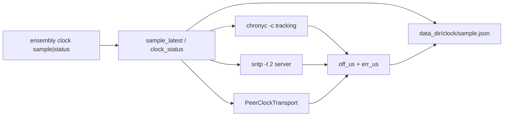

# Clock offset sampler (E1)

Future record events may carry an optional `clock` object:

```json
{ "off_us": 250, "err_us": 11750, "src": "chrony", "age_s": 12 }
```

`src` is `chrony`, `sntp`, `peer:<alias>`, or `none`. Microsecond digits are **resolution**, not accuracy; `err_us` is the honest bound from the source (not “precision”).

## Flow



## Semantics

| Field | Meaning |
|-------|---------|
| `off_us` | System clock offset vs the source (microseconds, signed) |
| `err_us` | Upper bound on magnitude of error (µs); `u64::MAX` when `src` is `none` |
| `src` | Provenance (no PII; peer aliases only) |
| `age_s` | Seconds since the cached sample was taken |

Linux prefers **chronyc** CSV (`Last offset`, `Root delay`, `Root dispersion` → `err_us = \|offset\| + dispersion + delay/2`, ceil µs). macOS uses **sntp** text (parser tested on fixtures from documented output; **needs verification on real Mac hardware**).

Peer mode uses the four-timestamp NTP offset/delay formula; `err_us = delay/2 + peer_err_us`. Transport is a trait only in this slice (no SSH yet).

Cache: `paths.data_dir/clock/sample.json` when configured, else `data/local/clock/sample.json`. Refresh if older than `--max-age-s` (default 60). Sampling is capped at ~2 s; on timeout or failure, return the last cache (with `age_s`) or `src: none`.

CLI: `ensembly clock sample` and `ensembly clock status`. Library: `ensembly_kernel::sample_latest`, `ensembly_kernel::clock_status`.