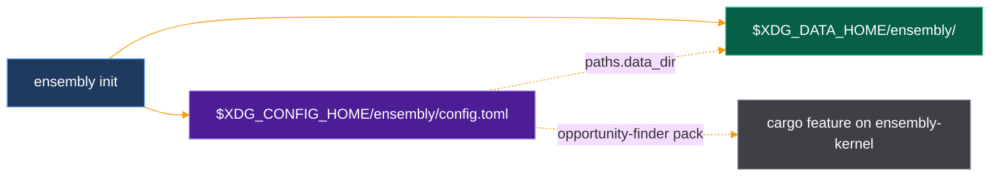

# Config

One file per user. Local only: ensembly sends no telemetry and makes no network call for config.



| Path | Default |
|------|---------|
| Config file | `${XDG_CONFIG_HOME:-$HOME/.config}/ensembly/config.toml` |
| Data dir | `${XDG_DATA_HOME:-$HOME/.local/share}/ensembly` |

A relative `XDG_*` value is ignored, as the XDG spec requires.

## Keys

| Key | Type | Default | Meaning |
|-----|------|---------|---------|
| `schema` | int | `1` | Config format version. Bumped only when a key changes meaning. |
| `paths.data_dir` | string | absolute `${XDG_DATA_HOME:-$HOME/.local/share}/ensembly` | Where kernel data lives: ops SQLite and episodic memory. `init` creates the directory. The runtime uses this when `--db` / `--memory` are omitted and no legacy `data/local/` files exist in the working directory. |

The optional **opportunity-finder** pack is **not** a config toggle: enable it with `cargo` feature `opportunity-finder` on `ensembly-kernel` at build time. See [docs/DECISIONS.md](DECISIONS.md).

Checked-in example: [config.example.toml](../config.example.toml).

## Commands

```bash
ensembly init            # write the default; prints the path
ensembly init --force    # replace an existing file
```

| Exit | Meaning |
|------|---------|
| 0 | Written. Path on stdout. |
| 1 | Error (no `HOME`, path not UTF-8, write failed) |
| 7 | File exists; refused without `--force`. The file is untouched. |

## Status: what reads each key

| Key | Read by |
|-----|---------|
| `paths.data_dir` | `init` (write default), runtime path resolution when `--db` / `--memory` are omitted |