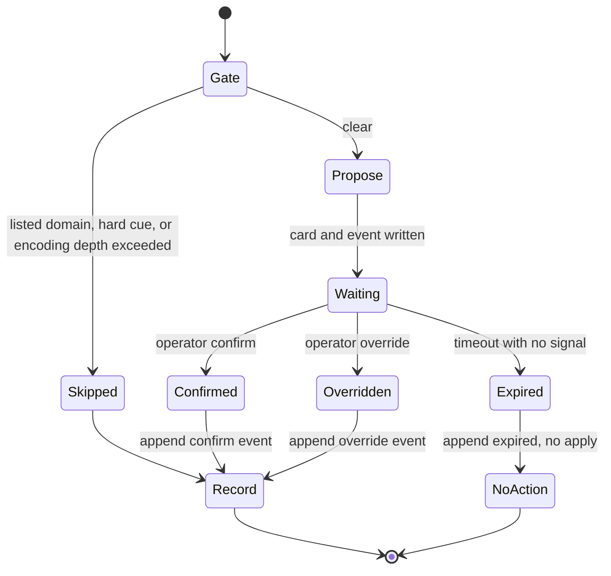

# Decision model (E3)

Local eval and propose-and-wait only. The decider is not live. It does
not submit an application. Silence never becomes an action.

The triage question is fixed: **Should this posting be labelled apply?**
Labels are `apply` and `skip`. The model may abstain and defer to the
operator.

## What ships now

- Schema and types in `ensembly-schema` (`LabelRow`, `DecisionEvent`, frozen
  `assign_split`).
- A scam-gate that runs first and is never learned. Fixture flags use
  `*.example.test` only. Listed domains are matched on the posting URL
  host and on hosts extracted from the posting text (case-insensitive,
  trailing dots stripped, subdomains included). Cue matching and host
  extraction share one normaliser and run on several views; a hit on
  any view is a hit. Views are derived from the raw text and from a
  single fixed-point canonicalisation of the body (and, separately, of
  URL authorities and extracted hosts). Each pass strips format and
  zero-width characters, decodes HTML named and numeric character
  references (from the vendored WHATWG HTML5 table; names are
  case-sensitive), percent-decodes one `%XX` layer, and applies
  Unicode and separator class folds. The loop repeats until the text
  stops changing, or until a hard cap of eight passes or a size bound
  of `2 * input_len + 64` bytes is hit. If the loop does not
  converge, or if a residual decode layer (`%XX`, `&name;`, or
  `&#...`) is still detectable after the cap, the gate verdict is
  `Fail` with reason `encoding-depth-exceeded`. That is fail-closed:
  the budget must never produce `Pass`. The verdict is `Fail` rather
  than `Uncertain` because soft-cue `Uncertain` is an abstain — it
  does not skip the posting, and the model defers to the operator.
  An exhausted budget is therefore treated as a hard fail so
  downstream skip stays in force. Views cover (a) format/zero-width
  stripped, (b) format/zero-width replaced by a space, (c) NFKC then
  combining marks removed and Cyrillic/Greek confusables folded (also
  applied to domains), (d) the converged (or budget-capped) decoded
  and class-folded forms, and (e) de-obfuscation of `[.]`,
  `(.)`, `{.}`, ` dot `, ` [dot] `, ` at `, and `[at]`, including
  spaces inside the brackets (`[ dot ]`, `( . )`). Ideographic and
  fullwidth stops (`U+3002`, `U+FF61`, `U+FF0E`) fold to ASCII `.` in
  host canonicalisation, authority parsing, and bare-text host
  extraction. Punycode `xn--` labels are decoded (RFC 3492, in-tree;
  no `idna` crate in the lockfile) before confusable folding.
  Cue matching also runs on an HTML-tag-stripped view, a view that
  turns punctuation between letters or words (`-`, `.`, `/`, `_`)
  into a space and joins single-letter runs (`w.i.r.e` → `wire`),
  a separate leet-fold view (`1→i`, `0→o`, `3→e`, `4→a`, `5→s`,
  `7→t`), and a junk-as-separator view derived from the fixed
  point and from the raw text. That view replaces every escape-shaped token with a space
  (for cues) or, in a second host view, with `.`, whether or not the
  token decodes: `&#` decimal and hex references (including invalid
  scalars such as surrogates and values above U+10FFFF, which become
  U+FFFD and then a space or `.`), named entities
  (`&` + a letter + alphanumerics, optional `;`, including unknown
  names such as `&zzzzz;` and `&NDASH;`), and `%` plus up to two
  non-whitespace characters. The junk view is used only for hard-cue
  and flag-host matching, never for the depth-residual rule, so
  ordinary text (`R&D`, `AT&T`, `Q&A`, `50% off`, `a && b`, utm
  `%20` URLs, ordinary job-ad HTML) does not trip
  `encoding-depth-exceeded`. The decoder itself stays case-sensitive:
  `&NDASH;` is not folded to `&ndash;`, but it is an unknown name
  and so fails on the cue via the junk-as-separator view. Cues must
  still be whole multi-word phrases after the replacement. A further
  token-stream view, also kept alongside the current views, collapses
  every run of characters that are not letters or digits (punctuation,
  symbols, dashes, spaces, format and zero-width characters, replacement
  characters, leftover escape junk) into one space and matches hard
  cues as whole token sequences, so `wire& money today` fails while
  `wire` inside `wireless` does not match. Two further views are built
  from that token stream: a letters-only view, where any non-letter run
  (digits included) becomes a space, so `wire2money today` fails; and a
  digit-stripped view, where a digit or other non-whitespace junk
  between two letters is deleted and the result is then tokenised, so
  `w2ire money today` fails while `wire2less` stays a whole token
  (`wireless`) and does not match. Hard cues are letter-only phrases
  and are matched in every view; a hit on any view is a fail. Ordinary
  tokens (`wireless`, ordinals like `2nd`, `w.i.p.`, version strings,
  prices) still pass unless they really form a cue. For flag hosts, any run of
  characters other than `[a-z0-9-]` between labels — including invalid
  or overlong percent sequences decoded to U+FFFD — becomes a single
  `.`, matched as a consecutive label window; ASCII `-` stays a label
  character. Before the punctuation-join, every Unicode Dash_Punctuation (`Pd`)
  code point plus minus (`U+2212`), hyphen bullet (`U+2043`) and
  the small/fullwidth hyphens (`U+FE63`, `U+FF0D`) folds to ASCII
  `-`; every Space_Separator (`Zs`) folds to a space; and slash
  or period lookalikes (`U+2044`, `U+2215`, `U+FF0F`, `U+2024`,
  `U+FE52`) fold to `/` or `.`. For hosts, a second view treats
  non-ASCII dashes between labels as `.`, while a hyphen view
  keeps them as ASCII `-`. ASCII `-` is never turned into `.`, so
  a real hyphenated domain stays distinct from a dotted flag:
  `phish-example.test` Passes on purpose and does not match the flag
  `phish.example.test`.
  The hard-cue phrase is `wire money/funds today/now`; `wire
  transfer` alone is deliberately not a hard cue. Soft cues
  (`Uncertain`) abstain: they are not a hard fail and do not skip
  the posting; the model defers to the operator.
- A transparent feature model and an untuned keyword baseline. Weights and
  the abstain band are fit on train only.
- Propose-and-wait through `KernelWriter`. Raw event-log writes are
  crate-private.
- A synthetic fixture set for tests. Those labels are invented and are
  not a claim about real accuracy.
- An empty labelling template for the operator. Real labels are not in
  this repository.

Held-out precision and accuracy, with a Wilson interval, are reported
only after the operator's held-out rows are labelled. Until then the
report says so and makes no accuracy claim. Eval JSON on a synthetic
fixture includes a `fixture_disclaimer` so those metrics cannot be
mistaken for operator-held-out claims.

`fit` and `pick_band` are public for tests and tooling, but they fit on
whatever rows they are given. Passing held-out rows into either is a
misuse; `decision eval` already restricts fitting to labelled train
rows.

## Statechart (written for this crate)



Rules:

- `rid` is `hash(link_key, "propose", model_version, snapshot_hash)`.
- Each step is idempotent on `(rid, event_type)`.
- The model never writes a posting status. Only an operator signal or a
  gate skip changes the proposal phase.
- Timeout (default 72 hours) writes `expired` and takes no action.
- A late confirm after expiry is refused. A new proposal needs a new rid.
- Writer identity is the configured `ENSEMBLY_WRITER` value.

## CLI

```bash
ENSEMBLY_WRITER=laptop-1 cargo run -p ensembly-kernel -- decision eval \
  --labels fixtures/decision/synthetic/labels.jsonl --json

ENSEMBLY_WRITER=laptop-1 cargo run -p ensembly-kernel -- decision template \
  --from postings.jsonl --out sheet.csv
```

`decision propose`, `confirm`, `override` and `expire` append to a sealed
decision event log through `KernelWriter`.

## What this is not

This milestone does not score the operator's real labelled set. It does
not turn silence into apply. It does not put the decider in the live
submit path.
