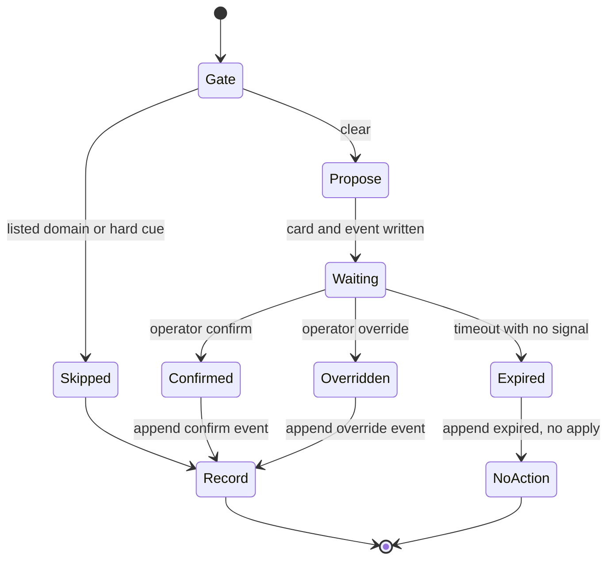

# Decision model (E3)

Local eval and propose-and-wait only. The decider is not live. It does
not submit an application. Silence never becomes an action.

The triage question is fixed: **Should this posting be labelled apply?**
Labels are `apply` and `skip`. The model may abstain and defer to the
operator.

## What ships now

- Schema and types in `ensembly-schema` (`LabelRow`, `DecisionEvent`, frozen
  `assign_split`).
- A scam-gate that runs first and is never learned. Fixture flags use
  `*.example.test` only.
- A transparent feature model and an untuned keyword baseline. Weights and
  the abstain band are fit on train only.
- Propose-and-wait through `KernelWriter`. Raw event-log writes are
  crate-private.
- A synthetic fixture set for tests. Those labels are invented and are
  not a claim about real accuracy.
- An empty labelling template for the operator. Real labels are not in
  this repository.

Held-out precision and accuracy, with a Wilson interval, are reported
only after the operator's held-out rows are labelled. Until then the
report says so and makes no accuracy claim.

## Statechart (written for this crate)



Rules:

- `rid` is `hash(link_key, "propose", model_version, snapshot_hash)`.
- Each step is idempotent on `(rid, event_type)`.
- The model never writes a posting status. Only an operator signal or a
  gate skip changes the proposal phase.
- Timeout (default 72 hours) writes `expired` and takes no action.
- A late confirm after expiry is refused. A new proposal needs a new rid.
- Writer identity is the configured `ENSEMBLY_WRITER` value.

## CLI

```bash
ENSEMBLY_WRITER=laptop-1 cargo run -p ensembly-kernel -- decision eval \
  --labels fixtures/decision/synthetic/labels.jsonl --json

ENSEMBLY_WRITER=laptop-1 cargo run -p ensembly-kernel -- decision template \
  --from postings.jsonl --out sheet.csv
```

`decision propose`, `confirm`, `override` and `expire` append to a sealed
decision event log through `KernelWriter`.

## What this is not

This milestone does not score the operator's real labelled set. It does
not turn silence into apply. It does not put the decider in the live
submit path.
