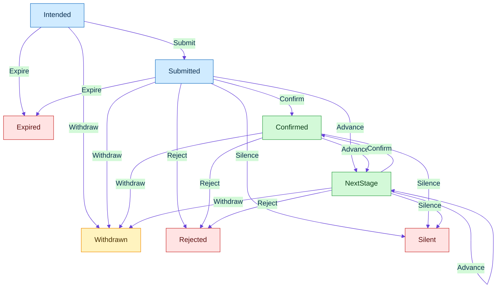

# Glossary — expanded abbreviations

**Rule:** no bare acronyms in law, docs, or review-facing text. Expand at first use in every document; keep this file as the single lookup. Add rows when a new term ships.

---

## Record layer

## Record status

| Term | Definition | Not | Source |
| --- | --- | --- | --- |
| `Intended` | Record status before a send | a submitted row | `ensembly_schema::record::Status::Intended` in `src/record.rs` |
| `Submitted` | Record status that stores a known or unknown submit time | a second submit of the same row | `ensembly_schema::record::Status::Submitted` in `src/record.rs` |
| `NextStage` | Record status with index n and evidence | a ledger status named interview | `ensembly_schema::record::Status::NextStage` in `src/record.rs` |
| `Rejected` | Record status that stores evidence of a refusal | a silent close | `ensembly_schema::record::Status::Rejected` in `src/record.rs` |
| `Withdrawn` | Record status for a row the operator closed | a rejection | `ensembly_schema::record::Status::Withdrawn` in `src/record.rs` |
| `Silent` | Record status that stores the time silence started | an expiry | `ensembly_schema::record::Status::Silent` in `src/record.rs` |
| `Confirmed` | Record status that stores confirmation evidence | any ledger status | `ensembly_schema::record::Status::Confirmed` in `src/record.rs` |
| `Expired` | Record status that stores an expiry time | a silent close | `ensembly_schema::record::Status::Expired` in `src/record.rs` |

## Event kind

| Term | Definition | Not | Source |
| --- | --- | --- | --- |
| `Submit` | Moves Intended to Submitted when a submit time is present | a record status | `ensembly_schema::record::EventKind::Submit` via `transition` in `src/record.rs` |
| `Confirm` | Moves Submitted or NextStage to Confirmed when evidence is present | a ledger status | `ensembly_schema::record::EventKind::Confirm` via `transition` in `src/record.rs` |
| `Reject` | Moves Submitted, Confirmed, or NextStage to Rejected when evidence is present | Silence | `ensembly_schema::record::EventKind::Reject` via `transition` in `src/record.rs` |
| `Advance` | From Submitted or Confirmed, opens NextStage at 1, and from NextStage adds one to n, saturating | a ledger interview row | `ensembly_schema::record::EventKind::Advance` via `transition` in `src/record.rs` |
| `Silence` | Moves Submitted, Confirmed, or NextStage to Silent when a time is present | Expire | `ensembly_schema::record::EventKind::Silence` via `transition` in `src/record.rs` |
| `Withdraw` | Moves Intended, Submitted, Confirmed, or NextStage to Withdrawn | Reject | `ensembly_schema::record::EventKind::Withdraw` via `transition` in `src/record.rs` |
| `Expire` | Moves Intended or Submitted to Expired when a time is present | Silence | `ensembly_schema::record::EventKind::Expire` via `transition` in `src/record.rs` |

## Ledger map

Checked by hand, not by `glossary_drift.rs`.

| Ledger | Record | Not | Source |
| --- | --- | --- | --- |
| `Prepared` | `Intended` | a submitted record | `ensembly_schema::apps_record::map_ledger_status` in schema `src/apps_record.rs` |
| `Submitted` | `Submitted` | an intended record | `ensembly_schema::apps_record::status_for` in schema `src/apps_record.rs` |
| `Interview` | `NextStage` with n = 1 and evidence source `legacy-unknown` | a record status named Interview | `ensembly_schema::apps_record::map_ledger_status` in schema `src/apps_record.rs` |
| `Rejected` | `Rejected` with evidence source `legacy-unknown` | a silent close | `ensembly_schema::apps_record::evidence` in schema `src/apps_record.rs` |
| `Withdrawn` | `Withdrawn` | a rejection | `ensembly_schema::apps_record::status_for` in schema `src/apps_record.rs` |
| `SilentClosed` | `Silent` with no evidence source | an expiry | `ensembly_schema::apps_record::closed_stage` in schema `src/apps_record.rs` |
| none | `Confirmed` | a mapped ledger status | `map_ledger_status` in schema `src/apps_record.rs` and `Status::from` in `src/record.rs` have no Confirmed arm |
| none | `Expired` | a mapped ledger status | `map_ledger_status` in schema `src/apps_record.rs` and `Status::from` in `src/record.rs` have no Expired arm |

## Adapter terms

Checked by hand, not by `glossary_drift.rs`.

| Term | Definition | Not | Source |
| --- | --- | --- | --- |
| `link_key` | Posting URL with trailing slashes removed and a final `/application` suffix removed | `apply_url`, or a link that still ends in `/application` | `ensembly_schema::ledger::link_key` in `src/ledger.rs` |
| `stage` | Token from `stage_token`: intended, submitted, withdrawn, silent, rejected, confirmed, expired, or `next-stage` plus the index | the ledger words prepared, interview, or silent-closed | `ensembly_schema::apps_record::stage_token` in schema `src/apps_record.rs` |
| `idempotency key` | The canonical `link_key`, a tab, and the stage token | a fresh key on retry, or the raw link plus the stage | `build_event` in schema `src/apps_record.rs` |
| `synthetic_time` | True when the ledger has no known submit time, so the event stores the import clock and compare treats the submit as unknown | a known submit time, or part of the idempotency key | `ensembly_schema::apps_record::AppEventPayload` in schema `src/apps_record.rs` |
| `replay` | Folds the log to the latest row per aggregate, where the highest version wins and a later line wins a tie, skips an identical event line for the same aggregate and key, and conflicts when any field of that line differs | a payload-only dedupe | `ensembly_schema::replay::replay` in `src/replay.rs` |
| `compare` | CLI-only `record apps compare` prints the report and writes nothing. Exit 0 is a match, exit 1 is a mismatch, exit 2 is an error, including a missing log or a directory given as the log | an MCP call, or an import that creates a missing log | `finish_compare` in `src/main.rs` and `ensembly_kernel::apps_record::compare_files` in kernel `src/apps_record.rs` |
| `writer alias` | The only writers accepted are `laptop-1`, `laptop-2`, and `mac-mini` | a hostname, a home path, or `box` | `ensembly_schema::surface::PUBLIC_HOST_ALIASES` in `src/surface.rs` |
| `legacy-unknown` | On import, Rejected and NextStage store this evidence source and text. The same spelling is the only unknown `cv_version` marker | the evidence source on Silent, or an ad-hoc `cv_version` label | `ensembly_schema::apps_record::evidence` in schema `src/apps_record.rs` and `ensembly_kernel::application_ledger::LEGACY_UNKNOWN_CV` in `src/application_ledger.rs` |
| `append-only` | Ledger append writes a new line. The kernel writer skips an identical key and payload, and refuses a different payload for the same key. Import appends events and does not rewrite a stored event or the ledger | an in-place edit of a ledger line or a stored event | `ensembly_kernel::writer::KernelWriter` in `src/writer.rs` and `ensembly_schema::apps_record::import_plan` in schema `src/apps_record.rs` |
| `ledger` | The application ledger is the source of truth that import reads and compare checks | the event log | `ensembly_schema::apps_record` in schema `src/apps_record.rs` and `ensembly_kernel::apps_record::import_ledger` in kernel `src/apps_record.rs` |

## Control plane (kernel)

| Term | Full text | What it means here |
|------|-----------|---------------------|
| **SoT** | Source of Truth | The one place a decision is made and stored. `crates/ensembly-kernel` is the control Source of Truth; everything else mirrors or advises. |
| **S** | Life-State | Durable operator state object (graph, regime, metrics, fingerprint) owned by the runtime. |
| **G** | Dependency Graph (`DepGraph`) | Directed graph of life actions with gates, realms, and dependencies. |
| **CP** | Critical Path | Longest-path chain through the dependency graph — the sequence that actually gates the day. |
| **P** | PERT + Monte Carlo | Program Evaluation and Review Technique (expected duration/σ per node) plus optional Monte Carlo sampling of path length. |
| **S+G+CP+P** | State + Graph + Critical Path + PERT | Shorthand for the whole Issue #1 runtime bundle. |
| **MsgBus** | Message Bus | Typed in-memory queue inside the runtime; every effect (manual command, trigger, agent report) travels as a message. |
| **HITL** | Human-In-The-Loop | Work that waits for an explicit human decision (approve/deny gates, physical claims). |
| **HOOTL** | Human-Out-Of-The-Loop | Digital thrash agents may clear autonomously because it is safe to do so. |
| **Digital thrash** | — | Low-value digital chores (triage, drafts) that clutter the critical path; HOOTL agents claim these. |
| **T1** | Tier 1 storage | Local ops SQLite (`data/local/ensembly-ops.sqlite`; legacy `peram-ops.sqlite` discovered) — durable, gitignored, never pushed. |
| **T2** | Tier 2 storage | Sealed/encrypted tier: vault bridge, backup packs (AES-GCM sealed blobs). |
| **IR** | Intermediate Representation | Versioned JSON/markdown contracts between pure kernel logic and hosts/agents (turn status IR, wait snapshot IR, graph IR). See MAP.md §4. |
| **Regime** | Loop Regime | Runtime mode: `Hootl` (agents clear digital work) vs `HitlWait` (blocked on a human gate/beacon). |

## Learning layer (ensembly-memory)

| Term | Full text | What it means here |
|------|-----------|---------------------|
| **CRDT** | Conflict-free Replicated Data Type | Data structure whose replicas merge without coordination; our trajectory/skills/goals document converges under concurrent CLI writers. Context merge keeps superseded values; it does not drop the prior preference. |
| **Supersession** | Freshness link | A later fact names the row or context value it replaces. Distinct from similarity. The old value stays as archive and leaves the live pulse. `ensembly pulse supersede` / `context_archive`. Essay: [Archive is not memory](https://captain.kingsparrow.space/articles/memory-issue/archive-not-memory). |
| **Trajectory** | Episodic trajectory | Append-only log of what actually happened: observations, actions, reflections. |
| **Coherence** | Coherence score | 0–1 similarity measure (word-set Jaccard) between consecutive trajectory entries; proxy for "does what I'm doing hang together". |
| **Skill synthesis** | — | When the same 3-action pattern repeats past threshold, it is crystallized into a named, reusable `Skill`. |
| **Reflect** | Reflection pass | Explicit `runtime reflect`: scores coherence, runs skill synthesis, proposes goals. Never implicit inside a control tick. |
| **Aux** | Auxiliary | The memory layer's legal status: it records and learns; it never decides authorize/deny, critical path, or priorities. |
| **Judge** | Inference provider (roadmap P2) | Pluggable backend for coherence scoring and reflection summaries. **Default:** deterministic Jaccard (zero network). **Optional adapters:** Ollama HTTP, Grok Model Context Protocol, opencode Agent Client Protocol / Model Context Protocol, pi, others — selected at runtime, never a hard dependency. Unavailable provider warns and falls back to deterministic. |
| **InferenceProvider** | Inference provider trait | Rust trait in `ensembly-agents`: score coherence, summarize reflection. Test oracle is always the deterministic implementation. |
| **DelegationBackend** | Delegation backend trait | Rust trait for Human-Out-Of-The-Loop digital hands. **First adapter:** Grok Agent Client Protocol. Secondary: opencode / pi. **Roadmap hand:** [participatory-mesh](https://github.com/thecuriousts/participatory-mesh) CommandFabric (`bin/mesh` / HTTP) — ensembly claims/completes; mesh **dispatches** allowlisted acts onto another participant. Mesh never decides life authorize/deny. See [thinking/mesh-bridge-2026-09-08.md](thinking/mesh-bridge-2026-09-08.md). |

## Agents and protocols (roadmap P3–P5)

| Term | Full text | What it means here |
|------|-----------|---------------------|
| **LLM** | Large Language Model | Any model via an InferenceProvider adapter. Fast path on this machine: Grok CLI `grok -p` ([docs](https://docs.x.ai/build/cli/headless-scripting)). Not a crate dependency. |
| **pi** | pi (agent runtime) | External agent/toolchain; secondary DelegationBackend adapter when wired. |
| **Grok ACP** | Grok Agent Client Protocol | Official: `grok agent stdio` — JSON-RPC NDJSON ([docs](https://docs.x.ai/build/cli/headless-scripting#acp)). |
| **Grok MCP** | Grok Model Context Protocol | Official: `grok mcp add` / `.grok/config.toml` ([docs](https://docs.x.ai/build/features/mcp-servers)). Tools namespaced `server__tool`. |
| **MCP** | Model Context Protocol | Standard JSON-RPC tool/resource surface for model hosts (Grok, Cursor, opencode, Eve). Live: `memory_*`, `swarm_banner`, `record_commit`, `record_view_snapshot`, `record_view_feed`. Reconcile and Sync are deferred. |
| **ACP** | Agent Client Protocol | Agent-to-agent session protocol (used by `opencode acp`); planned path for delegating HOOTL digital work. |
| **mesh** / **participatory-mesh** | Multi-device CommandFabric | Public: [thecuriousts/participatory-mesh](https://github.com/thecuriousts/participatory-mesh). Allowlisted task dispatch and shared operator governance across private-network participants. Increases ensembly value by executing approved work off-box; does not replace the life ledger. |
| **JSON-RPC** | JSON Remote Procedure Call | Request/response envelope used by MCP and ACP. |
| **NDJSON** | Newline-Delimited JSON | One JSON value per line; the stdio framing for our protocol plumbing. |
| **P2P** | Peer-to-Peer | Direct replica sync between machines; the CRDT merge is ready, transport is undecided (needs a product decision). |
| **Eve** | Vercel Eve | Production remote bridge candidate: channels, remote approval buttons, cron schedules — redacted IR only, never vault/persona. |

## Game and world

| Term | Full text | What it means here |
|------|-----------|---------------------|
| **WASM** | WebAssembly | `crates/peram-core` compiled to `public/game/pkg/` for the browser world sim. |
| **$SPN** | Spandan (game ticker) | Personal tape of real claim/HITL events rendered in the game host. |
| **Beacon** | Physical Beacon | Next physical-world action surfaced on the map; only a body can clear it. |
| **AuthGate** | Authorization Gate | Next pending approval; cleared only by an explicit human approve/deny. |

---

*Lost once already (IntelliArch `01_supervised/GLOSSARY.md`, uncommitted). Now committed here so it cannot silently vanish.*
