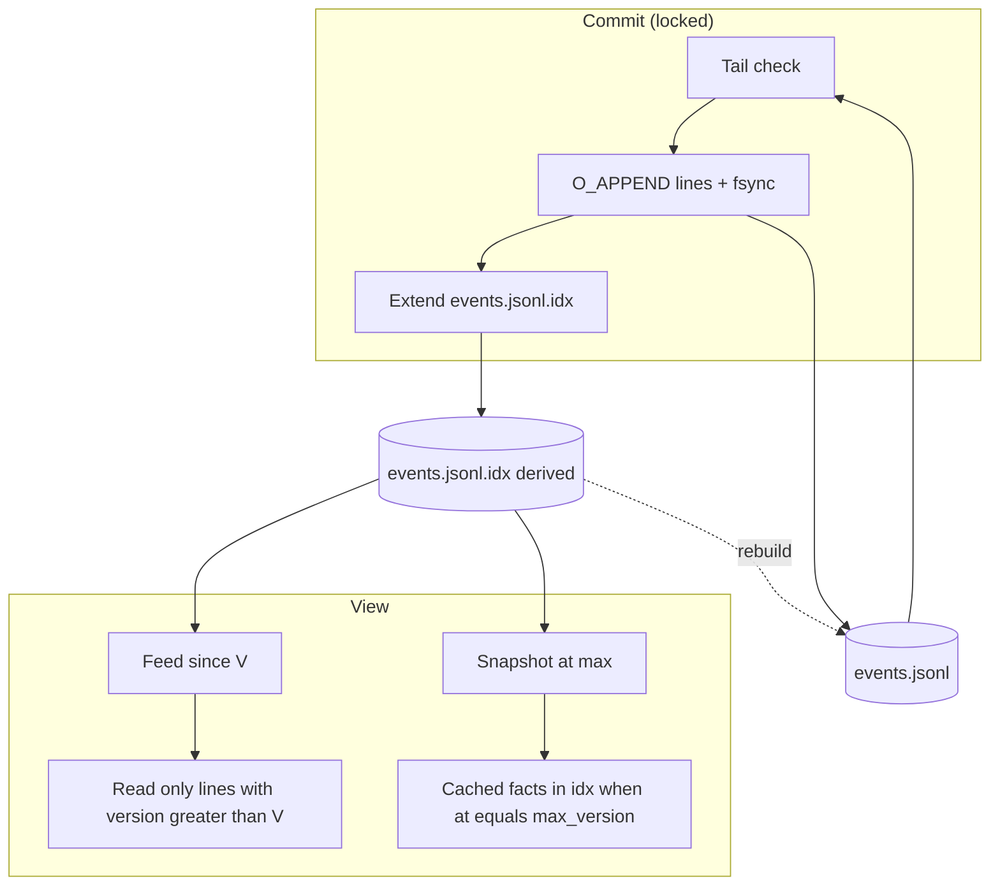

# Record log scale (slice 2)

| Piece | Rule |
|-------|------|
| **Append** | Staging, then `O_APPEND` into the log; never rewrite prior bytes. Torn final line → refuse; copy suffix to `events.jsonl.torn-fragment` (log unchanged). |
| **Sidecar** | `events.jsonl.idx`: `log_len`, hash of last complete line, per-line offsets, `keys_by_aggregate`, empty `keys_by_idempotency` (reserved). Safe to delete; rebuilt when stale. |
| **Snapshot** | At `max_version`, optional cached facts in the idx; otherwise indexed line reads + replay. |
| **Feed** | Index scan for `version > since`, then seek/read only those lines. |

Lines stay JSON objects per [`EventEnvelope`](../crates/ensembly-schema/src/record.rs): **extra members are ignored on read** so a future bus can add `occurred_at`, `recorded_at`, HLC, or source metadata without retiring existing files. Writers keep emitting today’s required fields until the Fleet spec lands.

Scaling numbers: run `RECORD_SCALE_BENCH=1 cargo test -p ensembly-schema --test record_scale --release`.

**read only · ran locally · tests and CI, not run**