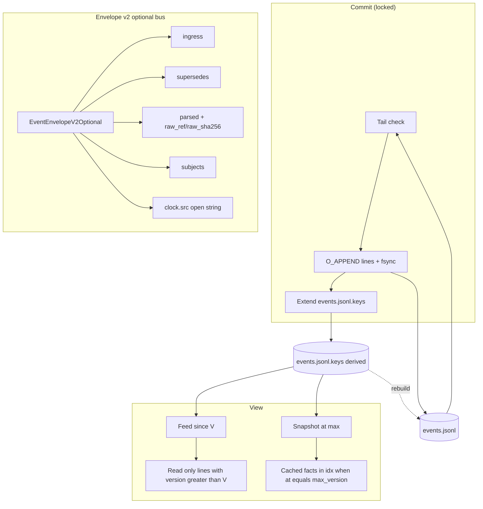

# Record log scale (slice 2)

| Piece | Rule |
|-------|------|
| **Append** | Staging, then `O_APPEND` into the log; never rewrite prior bytes. Torn final line → refuse; copy suffix to `events.jsonl.torn-fragment` (log unchanged). |
| **Sidecar** | `events.jsonl.keys`: header (`log_len`, `last_line_sha256`, `last_seq`, `last_hlc`), `(aggregate,key)→offset`, empty `keys_by_idempotency` (reserved). Safe to delete; rebuilt when stale. A live process keeps the index in memory and extends it on append (tail check reads the last line only). The keys file is rewritten on rebuild, not on every commit. |
| **Snapshot** | At `max_version`, optional cached facts in the idx; otherwise indexed line reads + replay. |
| **Feed** | Index scan for `version > since`, then seek/read only those lines. |
| **Ratio gate** | Release CI: `commit_ms(100k) / commit_ms(1k) ≤ 30` (`RECORD_SCALE_BENCH=1`, `record_scale` test). |

### Envelope v2 optional fields (`schema_v: 2`, wire `"v":2`)

All optional; omitted by default; `skip_serializing_if` on write; **never rewrite** existing lines. Top-level unknown keys rejected (`deny_unknown_fields` on `EventEnvelope` only).

| Field | Shape | Validation (reserve-only) |
|-------|--------|---------------------------|
| **ingress** | `{via?, provider?, msg_id?, sig?, sig_ok?, recv_ts_us?, path}` | `path` required when `ingress` present (`push` \| `reconcile`). `sig` is the provider signature **header value only** — never a secret or key. String subfields bounded. |
| **supersedes** | one event id or array | Normalized to array; ≤64 ids; ULID format. No referential check at write. Exposed as `EventEnvelope::supersedes_ids()` for pulse-style successor links. |
| **parsed** | `{state, parser, type?, summary?}` | `state`: `recognized` \| `decoded` \| `raw`. `parser`: `name@N`. `summary` bounded. Re-parse → **new** event with `supersedes`; never rewrite. |
| **raw_ref**, **raw_sha256** | strings | `raw_ref` bounded; `raw_sha256` exactly 64 **lowercase** hex (payload bytes, not the line). |
| **subjects** | string array | ≤32 entries; each non-empty, bounded length. |
| **clock** | `{off_us, err_us, src, age_s}` | `src` open string (`chrony`, `sntp`, `peer:<alias>`, `roughtime`, …). |
| **cause**, **depth**, **rule**, **ext** | earlier slice | `ext` bag: unknown keys inside `ext` ignored on read. |

Required on v2 **writes** (stamped under lock): `event_time_prec`, `node`, `seq`, `hlc`, `writer`, microsecond UTC `record_time`. Readers accept omitted / `v` 1 / 2 and `schema_v` 1 / 2.

Goldens: `fixtures/record-events-v1.jsonl` (byte-identical), `fixtures/record-events-v2-minimal.jsonl`, `fixtures/record-events-mixed-v1-v2.jsonl`, and `tests/fixtures/record-events-v2-full.jsonl` (contains `parser` `name@1`; excluded from the no-`@` fixture scan).

Scaling: `RECORD_SCALE_BENCH=1 cargo test -p ensembly-schema --test record_scale --release record_log_scaling_commit_and_feed -- --nocapture`.

### Release bench (Intel Xeon, cloud agent VM, `--release`)

`commit_ms` for append into a log with N−1 prior lines:

| Events | `origin/master` at merge (pre–slice-2 path) | slice 2 (`cursor/record-log-scale-slice2-3a97`) |
|--------|---------------------------------------------|--------------------------------------------------|
| 1k | 4.59 | 33.36 |
| 10k | 49.68 | 315.00 |
| 100k | run `RECORD_SCALE_BENCH=1` on `origin/master` baseline harness | same on branch (CI rust job) |

Ratio gate: `commit_ms(100k) / commit_ms(1k) ≤ 30` (`COMMIT_RATIO_MAX` in `tests/record_scale.rs`).