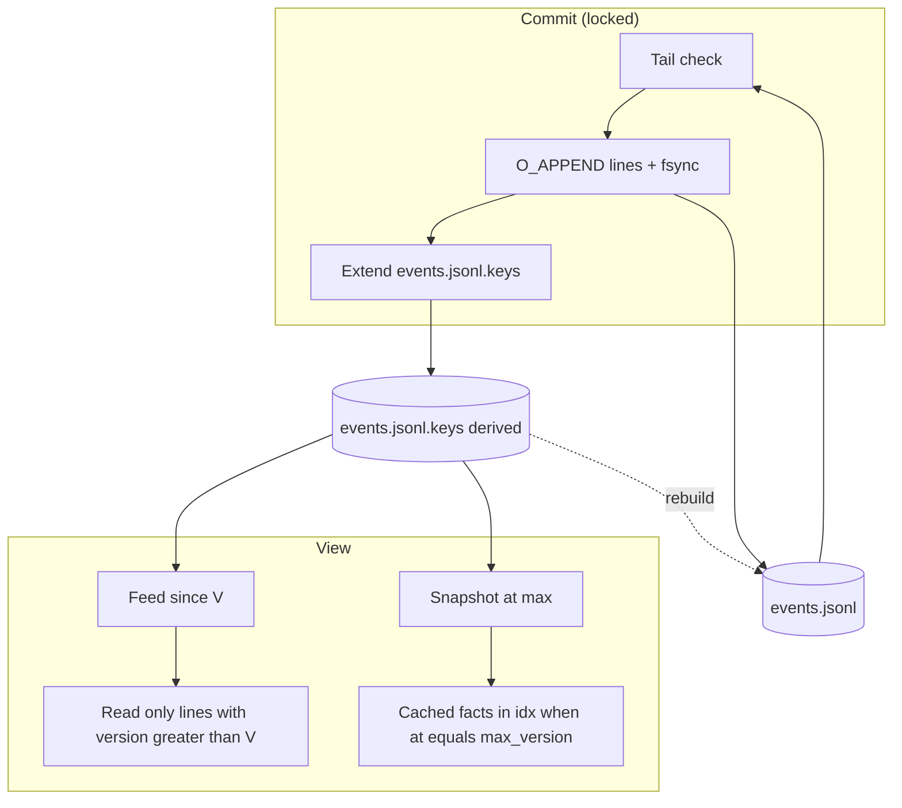

# Record log scale (slice 2)

| Piece | Rule |
|-------|------|
| **Append** | Staging, then `O_APPEND` into the log; never rewrite prior bytes. Torn final line → refuse; copy suffix to `events.jsonl.torn-fragment` (log unchanged). |
| **Sidecar** | `events.jsonl.keys`: header (`log_len`, `last_line_sha256`, `last_seq`, `last_hlc`), `(aggregate,key)→offset`, empty `keys_by_idempotency` (reserved). Safe to delete; rebuilt when stale. |
| **Snapshot** | At `max_version`, optional cached facts in the idx; otherwise indexed line reads + replay. |
| **Feed** | Index scan for `version > since`, then seek/read only those lines. |

**Envelope v2 (draft, field list pending):** writers emit wire `"v":2` and `schema_v:2` with required bus stamps (`event_time_prec`, `node`, `seq`, `hlc`, `writer`, microsecond UTC `record_time`). Optional bus keys are grouped on `EventEnvelopeV2Optional` (today: `clock`, `cause`, `depth`, `rule`, `ext`); Fleet may add `ingress`, `settle`, `supersedes`, etc. before ship — single `deny_unknown_fields` bump on `EventEnvelope` + optional struct, not a v3. `clock.src` is an open string (`roughtime` allowed). **Readers** accept omitted / `v`:1 / `v`:2 and `schema_v` 1 or 2 without rewriting old lines. v1 projection in views: `node=legacy`, line index `seq`, synthetic HLC from `record_time`.

Scaling numbers: run `RECORD_SCALE_BENCH=1 cargo test -p ensembly-schema --test record_scale --release`.

**read only · ran locally · tests and CI, not run**