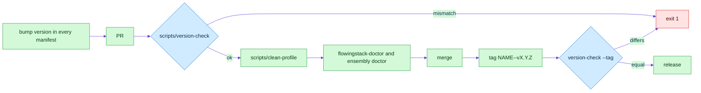

# Releases and doctor

## Version scheme

One tag per product, `NAME--vX.Y.Z`, the format `claude plugin tag` writes. The tag equals the version in every manifest of that product. Older `vX.Y.Z` tags are history and are not checked.

| Product | Tag | Version source |
|---|---|---|
| flowingstack | `flowingstack--vX.Y.Z` | `marketplaces/cursor/flowingstack/.cursor-plugin/plugin.json` and `.claude-plugin/plugin.json` |
| ensembly (Grok Bot plugin) | `ensembly--vX.Y.Z` | `marketplaces/grokbot/ensembly/plugin.json` |
| ensembly CLI | `ensembly-cli--vX.Y.Z` | `crates/ensembly-kernel/Cargo.toml` |

Claude Code caches a plugin by `version`, so a change shipped without a bump never reaches users. `scripts/version-check` fails when:

- manifests of one product disagree,
- the version is behind the newest tag of that product,
- files changed since the tag of the current version (bump first),
- with `--tag`, the tag is not `NAME--vX.Y.Z` or differs from the version.

Exit 0 consistent, 1 mismatch, 2 unreadable manifest or bad arguments. The `rails` workflow runs it on every PR and push, and with `--tag` on tag pushes.

## Doctor

| Command | Prints |
|---|---|
| `bin/flowingstack-doctor` inside the installed plugin | plugin version, both manifests, tools, Claude Code and Cursor install state, newest release tag |
| `ensembly doctor [--offline] [--json]` | CLI and kernel version, tools, installed flowingstack and ensembly plugins per harness, ops store health, newest `ensembly-cli` tag |

| Exit | Meaning |
|---|---|
| 0 | healthy; offline and missing optional tools still exit 0 (`latest offline` or `latest skipped`) |
| 1 | real breakage: manifests disagree, `installed_plugins.json` unreadable, an install path is gone, or the ops store fails `PRAGMA quick_check` |
| 2 | bad arguments; for flowingstack also an unreadable `.cursor-plugin/plugin.json` |

`--offline`, `FLOWINGSTACK_OFFLINE=1` or `ENSEMBLY_OFFLINE=1` skip the tag lookup. The lookup is `git ls-remote` with an 8 second limit. Both doctors only read.

## Clean-profile CI

`scripts/clean-profile WORKDIR` builds the CLI into a fresh `HOME`, points `CLAUDE_CONFIG_DIR` inside it, runs `claude plugin validate --strict`, installs flowingstack from a local marketplace built from committed files, links it as a Cursor local plugin, and checks both doctors online and offline. The Claude Code CLI is pinned in `.github/workflows/rails.yml`; validate, marketplace add and install need no login and no API key. The local marketplace lives only in the job's temp dir; no `marketplace.json` for Claude is committed.
