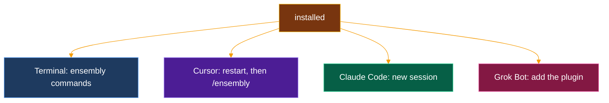

# Start here

A step-by-step guide for people who have never used a terminal. You copy each command, paste it, press Enter, and check that you see what the guide says you should see.

**Use Grok Bot?** The easiest way is to let Grok Bot do all of this on its own computer: paste one prompt from [install-with-grokbot.md](install-with-grokbot.md). You then need nothing below. Follow this guide when you want ensembly on your own computer, for Cursor, Claude Code or the terminal.


**Before you start, know this:**

- **Fast path:** download a prebuilt `ensembly` command from [GitHub releases](https://github.com/thecuriousts/ensembly/releases/latest) (see **Path A** below). That takes a few minutes and needs only **curl** (or a browser).
- **Fallback:** build from source (**Path B**) when no file matches your computer, the release is still a draft, or you hack the kernel. That path needs **git**, **Rust**, and about **4 GB** of free disk space the first time.
- You need an internet connection for either path.
- macOS and Linux are tested. Windows works through WSL (a Linux system inside Windows); that path is not tested yet.
- The example in step 7 uses made-up data. ensembly keeps its files on your own computer. The only thing it reaches out for is `ensembly doctor` without `--offline`, which asks GitHub for the newest version number.

## 1. Open a terminal

A terminal is a window where you type commands.

| Your computer | How to open it |
|---|---|
| **macOS** | Press `Cmd` + `Space`, type `Terminal`, press Enter. |
| **Linux** | Press `Ctrl` + `Alt` + `T`, or open the app menu and search for `Terminal`. |
| **Windows** | First install WSL: click Start, type `PowerShell`, right-click it, choose **Run as administrator**, then paste `wsl --install` and press Enter. Restart the computer when asked. If it says virtualization is turned off, it has to be switched on in the computer's firmware settings (search the web for your computer model plus "enable virtualization"). After the restart, open **Ubuntu** from the Start menu and choose a user name and password. Use that Ubuntu window as your terminal for every step below, and follow the **Linux** rows. Microsoft's guide: [Install WSL](https://learn.microsoft.com/windows/wsl/install). |

To paste into a terminal: `Cmd` + `V` on macOS, `Ctrl` + `Shift` + `V` on Linux and in Ubuntu on Windows (or right-click).

## 2. Install git and a C compiler

Rust needs a C compiler to finish building, and git downloads the code.

| Your computer | Paste this | What you should see |
|---|---|---|
| **macOS** | `xcode-select --install` | A window asks to install the command line developer tools. Click **Install** and wait until it says done. If the terminal says they are already installed, that is fine. |
| **Ubuntu, Debian, or Windows (Ubuntu)** | `sudo apt update && sudo apt install -y git curl build-essential` | It asks for your password (typing shows nothing; that is normal), then prints a lot of lines and returns to the prompt. |
| **Fedora** | `sudo dnf install -y git curl gcc` | Same as above. |

Check it worked: paste `git --version`. You should see something like `git version 2.47.3`.

You can jump to **Path A** below if you only want the prebuilt command (you still need a terminal from step 1).

## Path A — Prebuilt command (recommended)

Open [https://github.com/thecuriousts/ensembly/releases/latest](https://github.com/thecuriousts/ensembly/releases/latest). If the page says there are no releases yet, use **Path B**.

| Your computer | File to download |
|---|---|
| **Mac (Apple Silicon, M1/M2/M3…)** | `ensembly-*-aarch64-apple-darwin.tar.gz` |
| **Mac (Intel)** | `ensembly-*-x86_64-apple-darwin.tar.gz` |
| **Linux (Intel/AMD 64-bit)** | `ensembly-*-x86_64-unknown-linux-gnu.tar.gz` |
| **Linux (ARM 64-bit, e.g. Raspberry Pi 4+)** | `ensembly-*-aarch64-unknown-linux-gnu.tar.gz` |

The `*` is the version number (for example `0.5.1`). Also download **`SHA256SUMS`** from the same release page.

1. Open a terminal in the folder where the files downloaded.
2. Check the archive (replace the filename with yours):

```sh
shasum -a 256 -c SHA256SUMS
```

You should see `OK` for your `.tar.gz` file.

3. Unpack and install on your PATH:

```sh
tar -xzf ensembly-0.5.1-x86_64-unknown-linux-gnu.tar.gz
mkdir -p ~/.local/bin
cp ensembly-0.5.1-x86_64-unknown-linux-gnu/ensembly ~/.local/bin/
```

Use the folder name that matches your download. On macOS you can use `~/bin` instead of `~/.local/bin` if that is already on your PATH.

4. **macOS only** — if the computer says the app is from an unidentified developer:

```sh
xattr -d com.apple.quarantine ~/.local/bin/ensembly
```

5. Add the folder to PATH if needed (`export PATH="$HOME/.local/bin:$PATH"` in your shell profile), then check:

```sh
ensembly version
```

6. Continue at **step 6** below (`ensembly init`). For Cursor, Claude, or Grok plugins you still need the repo: clone in step 4 of **Path B** and run `sh scripts/install.sh --harness …` (the script prefers the same release asset when published).

## Path B — Build from source

## 3. Install Rust

Rust comes from its official installer, [rustup](https://rustup.rs). Paste this (it is the command shown on rustup.rs):

```sh
curl --proto '=https' --tlsv1.2 -sSf https://sh.rustup.rs | sh
```

When it asks, press Enter to choose the default install. It ends with `Rust is installed now. Great!`

Then **close the terminal and open a new one**, so it can find Rust. Check it worked:

```sh
cargo --version
```

You should see something like `cargo 1.100.0`. The exact number does not matter: ensembly asks for the version it needs and Rust fetches it on the first build (inside the `ensembly` folder, `cargo --version` then shows that version).

## 4. Download ensembly

```sh
git clone https://github.com/thecuriousts/ensembly.git
cd ensembly
```

You should see `Cloning into 'ensembly'...` and then the prompt again. Every later command runs from inside this `ensembly` folder. If you open a new terminal later, run `cd ensembly` first.

## 5. Run the installer

Pick the line for the tool you want to use. If you are not sure, use **all**.

| You want to use ensembly with | Paste this |
|---|---|
| Everything below | `sh scripts/install.sh --harness all` |
| Only the terminal | `sh scripts/install.sh --harness cli` |
| Cursor | `sh scripts/install.sh --harness cursor` |
| Claude Code | `sh scripts/install.sh --harness claude` |
| Grok Bot | `sh scripts/install.sh --harness grok` |

The first run downloads the Rust version ensembly needs and builds it. You see many `Compiling ...` lines for a few minutes. That is normal.

**Success looks like:** the last line is `done`. Above it you see a `== next` section.

What the installer does, and nothing more:

- builds the `ensembly` command and puts it where Rust keeps its commands (`~/.cargo/bin`)
- for Cursor: copies the ensembly plugin into `~/.cursor/plugins/local/ensembly`
- for Claude Code: links the three ensembly skills into `~/.claude/skills`
- for Grok Bot: prints how to add the plugin (it writes nothing)

It never uses `sudo` and never installs other software. If a folder or link with the same name is already there and it did not make it, it leaves it alone and tells you.

For **Cursor**, it copies the plugin into `~/.cursor/plugins/local/ensembly` and writes a marker file `.ensembly-installed-from` containing the checkout path it copied from. Later runs replace that copy only when the marker matches **this** checkout (an interrupted copy still has the marker, so the next run retries). Any other existing folder is left alone.

## 6. Create your settings

```sh
ensembly init
```

**Success looks like:** one line with the path of your new settings file — typically:

```text
${XDG_CONFIG_HOME:-$HOME/.config}/ensembly/config.toml
```

(for example `/home/user/.config/ensembly/config.toml` on Linux, or `~/Library/Application Support` paths only if you set `XDG_CONFIG_HOME` that way on macOS). Your ensembly data will live in `${XDG_DATA_HOME:-$HOME/.local/share}/ensembly`.

Running it a second time prints `refused without --force` and changes nothing. That is on purpose: it never overwrites your settings.

## 7. Check it and try it

```sh
ensembly doctor --offline
```

**Success looks like** a short report. These lines matter:

| Line | Means |
|---|---|
| `ensembly-cli 0.5.1` (or newer) | the command works |
| `harness cursor present` and `plugin cursor ensembly 0.1.0` | the Cursor plugin is in place (only if you installed for Cursor) |
| `ops-db absent` | normal before your first use |
| `tool claude missing` or `tool cursor-agent missing` | fine; those are optional |

Now try a built-in example: a small made-up day with four tasks, where one needs your approval.

```sh
ensembly runtime load --fixture fixtures/issue-1-runtime.json
ensembly runtime status
ensembly runtime approve pay-rent
ensembly runtime claim grocery-errand
ensembly runtime complete grocery-errand
```

**Success looks like:** among the lines you see `RUNTIME_LOAD ok`, `# LifeState v` followed by a number, `RUNTIME_APPROVE id=pay-rent`, `RUNTIME_CLAIM id=grocery-errand`, and `RUNTIME_COMPLETE id=grocery-errand`. Run `ensembly doctor --offline` again and it now says `ops-db ok`.

The example remembers what you did. If you run it a second time, `approve` prints `Error: approval already Approved`: that means the first run worked, and the other commands still run.

Optional, the full self-test (it rebuilds and runs every test, so it takes longer):

```sh
sh scripts/stranger-test.sh
```

It uses a throwaway folder, so it does not touch your settings. The last line is `== green`.

## 8. Use it in your tool



The `ensembly` command keeps the record: which tasks are approved, claimed, and completed. The plugin's three skills (`ensembly`, `record-layer`, `verified-retrieve`) teach your AI assistant the same rules: one owner per fact, dated rows, write the intent, act, then check.

| Tool | What to do |
|---|---|
| **Terminal** | Use the commands from step 7. `ensembly --help` lists them all. |
| **Cursor** | Quit Cursor fully and open it again (or run **Developer: Reload Window** from the command palette). Open **Customize**: the three skills are listed. In chat, type `/ensembly`. For the flowingstack plugin (task contracts and review checks), see [its README](../marketplaces/cursor/flowingstack/README.md). |
| **Claude Code** | Start a new Claude Code session. The skills show as `ensembly`, `record-layer`, and `verified-retrieve`. Ask it to load the `ensembly` skill. |
| **Grok Bot** | Easiest: paste the prompt from [install-with-grokbot.md](install-with-grokbot.md). Or, in Grok Bot, add the GitHub marketplace `thecuriousts/ensembly` and install the `ensembly` plugin, or install a local plugin from the folder `marketplaces/grokbot/ensembly`. Then, in any bot, load the `ensembly` skill. |

The job-search pack (opportunity-finder) is not installed. It is optional and only built when someone asks for it: see [its README](../crates/ensembly-opportunity-finder/README.md).

## If this goes wrong

| You see | Do this |
|---|---|
| `cargo: command not found`, or the installer says `warn: cargo not found` and `missing prerequisites` | Close the terminal and open a new one. If it still fails, run `. "$HOME/.cargo/env"` and try again, or redo step 3. |
| `git: command not found`, or `git not found` | Redo step 2. |
| `ensembly: command not found` after the installer said `done` | Close and reopen the terminal. If the installer printed `warn: ... is not on PATH`, paste the `export PATH=...` line it showed. |
| `linker 'cc' not found`, or an error mentioning `libsqlite3-sys` or `cc` | The C compiler is missing: redo step 2. |
| `cannot open scripts/install.sh` or `No such file or directory` | You are in the wrong folder. Run `cd ~/ensembly` and try again. |
| `fatal: destination path 'ensembly' already exists` | You downloaded it before. Run `cd ensembly`, then `git pull`, and carry on from step 5. |
| `warn: skip ...: exists and was not installed from this checkout`, `warn: skip ...: exists and is not a link`, or `warn: skip ...: links to ..., not this checkout`, and the last line is `error: some links or copies were skipped` | Something with that name was already there, and the installer will not touch what it did not make. The warning names the path. Move it somewhere else, for example `mv ~/.claude/skills/ensembly ~/ensembly-old-skill`, then run the installer again. |
| `init: ... exists; refused without --force` | You already ran `ensembly init`. Nothing is wrong. |
| `Error: approval already Approved` | You already ran the example. Nothing is wrong. |
| Many `Compiling ...` lines for several minutes | Normal on the first run. Wait. |
| Cursor does not show the skills | Quit Cursor fully and reopen it. Run `ls -la ~/.cursor/plugins/local/`: the `ensembly` line must start with `d` (a folder), not `l` (a link). On company (Enterprise) Cursor, an admin must allow local plugins. |
| `No space left on device` | Free at least 4 GB and run the installer again. |

## Update or remove

- **Update:** `cd ensembly`, then `sh scripts/install.sh --update --harness all`. It downloads the latest code and installs it again.
- **Remove:** `cargo uninstall ensembly-kernel` removes the command. If you installed for Cursor or Claude Code, also run:

  ```sh
  rm -rf ~/.cursor/plugins/local/ensembly
  rm ~/.claude/skills/ensembly ~/.claude/skills/record-layer ~/.claude/skills/verified-retrieve
  ```

  Your settings are in `~/.config/ensembly` and your data in `~/.local/share/ensembly`; delete those only if you want them gone.

More detail for developers: [README](../README.md), [settings](CONFIG.md).
