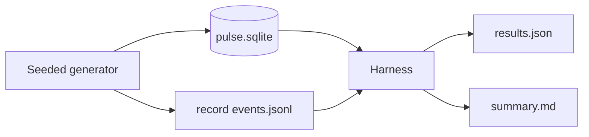

# Retrieval benchmark (slice 1a)



| Piece | Role |
|-------|------|
| Generator | Builds `1k` / `10k` / `100k` synthetic pulse rows and record-log events (record writes use `ensembly-schema` commit). |
| Query set | 50 unique terms; 20 natural-phrased (filler words); 10 paraphrase+extra terms; 10 FTS all-terms zero-hit; 20 old-vs-new pairs (mixed `last_seen` offsets); 20 prefixes — golden keys by construction. |
| Harness | Times the same kernel/schema paths the CLI uses; scores recall and fresh-first rank. |
| CI | Runs `1k` + `10k`, uploads artifacts; **does not fail on numbers yet**. |

## Run locally

```bash
cargo run -p retrieval-bench -- --sizes 1000,10000 --out target/retrieval-bench
cargo test -p retrieval-bench
```

Optional `100k` (slow): `--sizes 100000`. Nightly/flag in CI: set `RETRIEVAL_BENCH_100K=1`.

Outputs under `--out`: `results.json` (machine-readable, includes `EXPLAIN QUERY PLAN` for hot pulse queries), `summary.md`.

## Metrics

| Metric | Meaning |
|--------|---------|
| `prefix_read` p50/p95 | `pulse_core::read_prefix` on a planted prefix. |
| `fts_search` | `read_search` on a planted unique token (FTS path). |
| `fallback_text_search` | `read_search` with FTS-hostile input → LIKE fallback. |
| `pulse_list` | `pulse_supersede::list_live`. |
| `dangling_supersession_check` | `pulse_core::db_stats` (includes dangling supersession query). |
| `record_log_snapshot` | `snapshot_json` on the generated log. |
| `single_event_commit` | One-event `commit_json` append. |
| `feed_last_10` | `feed_json` since `version - 10`. |
| `recall@5` / `recall@10` per type | `unique`, `natural_phrase`, `paraphrase_extra`, `fts_zero_hit`, `prefix` (all 20 prefixes scored). |
| `fresh_first_accuracy` | For old-vs-new pairs, search ranks the newer row first. |

On current search paths, `natural_phrase`, `paraphrase_extra`, and `fts_zero_hit` are expected to score **low** (honest baseline).

Synthetic recall catches retrieval regressions on known corpora; it does **not** prove real-world operator quality on live pulse stores.