# ensembly first run for Grok Bot

This file is a first-run instruction for Grok Bot. Follow every step, in order, as one continuous run, starting with step 0. The user pasted the prompt from [docs/install-with-grokbot.md](../install-with-grokbot.md); `~/ensembly` is already cloned or updated.

```mermaid
%%{init: {"theme":"base","themeVariables":{"primaryColor":"#1e3a5f","primaryTextColor":"#ffffff","lineColor":"#f59e0b","fontFamily":"Inter"}}}%%
flowchart LR
  subgraph core["Core: always, steps 1-8"]
    D[1 Detect] --> R[2 Rust] --> G[3 Install] --> I[4 init] --> DR[5 doctor] --> PL[6 Plugin] --> S[7 State file] --> PG[8 Page]
  end
  subgraph opt["Optional: one card each, steps 9-11"]
    T[9 Full test] --> H[10 Other tools] --> B[11 Bot]
  end
  PG --> T
  B --> E[12 Finish]
  classDef c fill:#1e3a5f,stroke:#60a5fa,color:#ffffff
  classDef o fill:#78350f,stroke:#fbbf24,color:#ffffff
  classDef e fill:#065f46,stroke:#34d399,color:#ffffff
  class D,R,G,I,DR,PL,S,PG c
  class T,H,B o
  class E e
```



## Step 0. Rules for the whole run

- Never skip a step. Never end your turn in the middle of setup. Stop only to show a question card, and carry on as soon as it is answered.
- Ask one question card at a time. Preselect nothing. Every multi-select ends with "None of these".
- A dismissed or expired card counts as No. Do not ask it again in chat.
- Optional steps never stall setup. If one is skipped or fails, note it as unfinished and go on.
- Never ask for a password, token or API key. ensembly needs none.
- Never use sudo.
- Never delete, move or overwrite a file or folder of the user's without asking first. Never move existing data. Never run `ensembly init --force`.
- Leave the optional opportunity-finder pack off. Mention it once, as optional.
- Do not post anything anywhere. Do not create a bot without a yes.
- Keep chat short: one line when you start, one line per finished step, then the final summary. Use plain words.
- The state file is the record of this install, not your memory. Read it in step 1, write it in step 7, update it after every later step.

Paths used below:

| Name | Path |
|------|------|
| Checkout | `~/ensembly` |
| Config | `$XDG_CONFIG_HOME/ensembly/config.toml`, or `~/.config/ensembly/config.toml` when `XDG_CONFIG_HOME` is not set |
| State file | `grokbot-install.json` in the same folder as the config |

## Step 1. Detect an earlier install

- Read the state file if it exists. If it cannot be read, or its `schema` is not 1, do not overwrite it: copy it to `grokbot-install.json.bak-<YYYYMMDD-HHMMSS>` (a new name, so nothing is overwritten), say so in one line, and treat this run as an earlier install without a state file. Step 7 then writes a fresh one.
- Check whether the config file exists.
- Check whether `ensembly version` runs. If not, try `~/.cargo/bin/ensembly version`.
- Say one line: "New install", or "Found an earlier install: <version>, <harnesses>, Page <link or none>, bot <name or none>. I will update it in place."
- An earlier install is updated in place: the same checkout, config, Page and bot. Never create a second copy of any of them.

## Step 2. Check Rust

- If `~/.cargo/env` exists, run `. "$HOME/.cargo/env"` first, in the same command as the checks.
- Run `cargo --version` and `rustup --version`.
- If both work, go on. rustup fetches the Rust version pinned in `~/ensembly/rust-toolchain.toml` by itself on the first build.
- If either is missing, ask with a question card: "ensembly needs Rust to build. May I download the official rustup installer from rustup.rs and run it to install Rust into my own home folder, without sudo?" Choices: "Yes, install Rust" and "No".
- On yes, run `curl --proto '=https' --tlsv1.2 -sSf https://sh.rustup.rs | sh -s -- -y --no-modify-path`.
- From here on, if `~/.cargo/env` exists, start every command that uses cargo or ensembly with `. "$HOME/.cargo/env" && `, because each command may run in a fresh shell.
- On no or a dismissed card, the core install cannot run. Say so in one line, skip to step 12, and report that nothing was installed.

## Step 3. Install for Grok Bot

- New install: `cd ~/ensembly && sh scripts/install.sh --harness grok`
- Earlier install: `cd ~/ensembly && sh scripts/install.sh --update --harness grok`
- This builds the `ensembly` command. The first build takes several minutes. Success: the last line is `done`.
- If it warns that a folder is not on PATH, run the `export PATH=...` line it prints before every later ensembly command in this run.
- The `grok` harness writes nothing else. It prints a hint about adding a local plugin; follow step 6 instead.
- If the error mentions "linker cc not found" or a missing C compiler: the build needs one (it compiles SQLite). Tell the user plainly: on a Mac, `xcode-select --install`; on Linux, the system's build tools package. Do not use sudo to install it yourself.
- If it fails, show the last 20 lines, explain them in plain words, skip to step 12, and report the failure.

## Step 4. Write the config

- Run `ensembly init`.
- Exit 0 prints the path of the new config file.
- Exit 7, with the message `init: <path> exists; refused without --force`, means the config file already exists. It is untouched; keep it. That is success.
- Read the `data_dir` line from the config file for the Page.

## Step 5. Fast check

- Run `ensembly doctor --offline`. It only reads. It prints the ensembly version, the tools it finds (git, python3, claude, cursor-agent), whether Claude Code and Cursor have the plugin, the state of the ops database, and any `fail` lines.
- Success: exit code 0 and no line starting with `fail`. `ops-db absent` is normal before ensembly is first used. `tool ... missing` is only information.
- If there are `fail` lines, explain each in one line. Go on; the Page lists them.

## Step 6. Add the plugin

- The skills come from the `ensembly` plugin. Try to load the `ensembly` skill. If it loads, the plugin is there; go on.
- Otherwise ask with a question card: "In Grok Bot's plugin settings, add the GitHub marketplace thecuriousts/ensembly, then install the ensembly plugin. Tell me when it is done." Choices: "Done" and "Skip for now".
- On "Done", load the `ensembly` skill again to confirm. On "Skip for now" or a dismissed card, note the plugin as unfinished and go on.

## Step 7. Write the state file

Write the state file now, creating its folder only if it is missing. It belongs to this installer, so you may rewrite it on every run. Keep any field from an earlier run that this run did not change.

```json
{
  "schema": 1,
  "updated": "<now, ISO 8601 with offset>",
  "checkout": "~/ensembly",
  "commit": "<git -C ~/ensembly rev-parse --short HEAD>",
  "version": "<first line of ensembly doctor --offline>",
  "config": "<config file path>",
  "data_dir": "<data_dir from the config>",
  "plugin": "added | skipped",
  "harnesses": { "grok": "installed" },
  "full_test": "not run",
  "page": "<Page link, filled in step 8>",
  "bot": null,
  "routines_offered": {}
}
```

## Step 8. Write or edit the Page

- If the state file has a Page link, or a Page titled "Ensembly on Grok Bot" already exists, edit that Page. Otherwise write a new Page with that title. Never make a second one.
- Cover, in plain words:
  - What ensembly is: a small local tool that keeps a dated record of what bots propose, what the user approves, and what got done.
  - What got installed: the checkout and its commit, the ensembly version, where the `ensembly` command lives, and whether the plugin is added.
  - Where the data lives: the config path and `data_dir`. Existing `data/local` files in a working folder still win, and nothing was moved.
  - The state file path, and that a re-run reads it.
  - How to update: paste the install prompt again, or run `cd ~/ensembly && sh scripts/install.sh --update --harness grok`.
  - How to check it: `ensembly doctor --offline`, and `sh scripts/stranger-test.sh` for the full test.
  - That opportunity-finder is an optional pack that stays off.
  - Anything unfinished, and today's date.
- Save the Page link in the state file. Say one line: "Core setup done."

## Step 9. Optional: full test

- Ask with a question card: "Run the full test now? It uses a throwaway folder, touches none of your data, and takes ten minutes or more." Choices: "Run it now" and "Not now".
- On "Run it now": `cd ~/ensembly && sh scripts/stranger-test.sh`. Success: it ends with `== green` and exit code 0. If it fails, name the last line starting with `==` and the error in plain words.
- Record `green`, `failed` or `not run` as `full_test` in the state file.

## Step 10. Optional: other tools

- Ask with a question card, multi-select: "Which of these do you also use on your own computer?" Choices: "Cursor", "Claude Code", "Plain command line", "None of these". Preselect nothing.
- These run on the user's computer, not yours. For each choice, give one block of commands to paste into a terminal there, and say what success looks like. Say how to open a terminal: on a Mac, the Terminal app; on Linux, the terminal app. git and cargo are needed there too; the installer says how to get them.
- Each block is three lines, with `HARNESS` replaced by `cursor`, `claude` or `cli`. It works in a new terminal and on a computer that already has ensembly:
  ```sh
  [ -d ~/ensembly ] || git clone https://github.com/thecuriousts/ensembly ~/ensembly
  cd ~/ensembly
  sh scripts/install.sh --update --harness HARNESS && { ensembly init; ensembly doctor --offline; }
  ```
- Success for every block: the installer prints `done`; `ensembly init` prints the config path or says the config already exists ("refused without --force" is fine); `ensembly doctor --offline` shows no line starting with `fail`.
  - Cursor: then restart Cursor. The ensembly skill shows in Cursor.
  - Claude Code: then start a new Claude Code session. The skills ensembly, record-layer and verified-retrieve show.
  - Plain command line: nothing more.
- If the installer warns that a folder is not on PATH, or `ensembly` is not found, tell the user to run the `export PATH=...` line it prints, then run the last two commands again: `ensembly init` and `ensembly doctor --offline`.
- If the installer skips a link because something is already there, tell the user to leave it and ask you. Never tell them to delete it.
- Record each choice as `"commands given"` under `harnesses` in the state file. On "None of these" or a dismissed card, go on.

## Step 11. Optional: dedicated Ensembly bot

- If the state file names a bot, or a bot named exactly "Ensembly" already exists, do not create another. Send it the first message from [docs/ensembly-bot-template.md](../ensembly-bot-template.md) so it has the current instructions, and go on. The first message tells it not to offer routines again that already exist or were declined.
- Otherwise ask with a question card: "Want a dedicated Ensembly bot that owns setup, updates and troubleshooting?" Choices: "Yes" and "No".
- On "Yes", if you can create bots (CreateAgent): create one named "Ensembly" with the job and description from the template, then send it the template's first message. Record `"bot": "Ensembly"` in the state file.
- On "Yes" when you cannot create bots: say so in one line and give the user `~/ensembly/docs/ensembly-bot-template.md` to use when they create the bot themselves. Do not act as that bot yourself.
- On "No" or a dismissed card, go on.

## Step 12. Finish

- Update the Page and the state file with the final results.
- Say "Ensembly setup complete", then one short summary: what is installed, the Page link, anything unfinished, and two example asks, such as "Update ensembly" and "Check that ensembly works".
