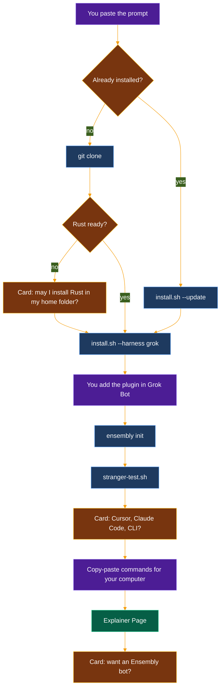

# Install with Grok Bot

Paste one prompt into Grok Bot. It installs ensembly on its own computer, asks which other tools you use, and leaves you a Page that explains what it did.



| | |
|--|--|
| **Where it runs** | Grok Bot's own computer, with its own shell. Cursor, Claude Code and the plain CLI run on *your* computer, so Grok Bot gives you commands to paste there. |
| **What it installs** | This repo at `~/ensembly`, the `ensembly` command, and the `ensembly` plugin (you click to add it in Grok Bot). |
| **Data** | Config at `~/.config/ensembly/config.toml`. Data folder at `~/.local/share/ensembly` (the `data_dir` line in the config). Existing data is never moved. |
| **Safe to re-run** | It finds the existing install and updates it. `ensembly init` keeps an existing config (exit 7 means "already there"). |
| **Never** | Asks for passwords, tokens or keys. Uses `sudo`. Deletes, moves or overwrites files without asking. Turns on opportunity-finder. Posts anything. Creates a bot without your yes. |
| **Done looks like** | The installer ends with `done`. The stranger test ends with `== green`. You get a Page called "Ensembly on Grok Bot". |
| **Time** | The first build takes several minutes. The stranger test runs every test and can take ten minutes or more. |

Copy everything inside the box below and paste it into a new Grok Bot chat. To update later, paste it again. The dedicated bot it offers is described in [ensembly-bot-template.md](ensembly-bot-template.md).

## The prompt

```text
Set up ensembly for me. ensembly is a small local tool that keeps a dated record of what my bots propose, what I approve, and what got done. Its source is https://github.com/thecuriousts/ensembly. Do the work on your own computer with your shell. Talk to me in plain words; I may not be a developer.

Rules for the whole job:
- Never ask me for a password, token or API key. ensembly needs none.
- Never use sudo.
- Never delete, move or overwrite a file or folder. If something is in the way, stop and ask me with a question card.
- Never run `ensembly init --force`.
- Leave the optional opportunity-finder pack off. Mention it once as optional, nothing more.
- Do not post anything anywhere. Do not create a bot unless I say yes.
- Before each step, tell me in one sentence what you are about to do. After it, tell me whether it worked.

Step 1. Check what is already there.
- Does ~/ensembly exist? If it does, run `git -C ~/ensembly remote get-url origin` and `git -C ~/ensembly status --porcelain`.
- Does the config file exist? It is $XDG_CONFIG_HOME/ensembly/config.toml, or ~/.config/ensembly/config.toml when XDG_CONFIG_HOME is not set.
- Does `ensembly version` run? Also try ~/.cargo/bin/ensembly version.
- If ~/ensembly exists but its origin is not thecuriousts/ensembly, or the status command prints anything, stop and ask me what to do.
- Tell me which case this is: "new install" or "existing install, I will update it".

Step 2. Get the code.
- New install: run `git clone https://github.com/thecuriousts/ensembly ~/ensembly`.
- Existing install: do nothing here. The installer updates it in step 4.
- If git is missing, tell me and stop.

Step 3. Check Rust.
- Run `cargo --version` and `rustup --version`, and read the channel line in ~/ensembly/rust-toolchain.toml.
- If rustup works, go on. rustup fetches the pinned Rust version by itself on the first build.
- If cargo or rustup is missing, ask me with a question card whether you may install Rust with rustup into your own home folder, without sudo. Only on yes, run `curl --proto '=https' --tlsv1.2 -sSf https://sh.rustup.rs | sh -s -- -y --no-modify-path`, then `. "$HOME/.cargo/env"`. On no, stop and explain that the build needs Rust.

Step 4. Install for Grok Bot.
- New install: `cd ~/ensembly && sh scripts/install.sh --harness grok`
- Existing install: `cd ~/ensembly && sh scripts/install.sh --update --harness grok`
- The first build takes several minutes. Success: the last line is `done`.
- If it warns that a folder is not on PATH, run the `export PATH=...` line it prints before every later ensembly command in this job.
- If it fails, including when `git pull --ff-only` refuses, show me the last 20 lines, explain them in plain words, and stop.

Step 5. Add the plugin.
- The installer writes nothing for Grok Bot. The skills come from the `ensembly` plugin.
- First try to load the `ensembly` skill. If it loads, the plugin is already there; skip the rest of this step.
- Otherwise ask me to do this in Grok Bot's plugin settings: add the GitHub marketplace `thecuriousts/ensembly`, then install the `ensembly` plugin. Use a question card with the choices "Done", "I need help" and "Skip for now".
- On "Done", load the `ensembly` skill again to confirm. On "Skip for now", go on and list it as unfinished at the end.

Step 6. Write the config.
- Run `ensembly init`.
- Exit 0 prints the path of the new config file.
- Exit 7 means a config file already exists. It is untouched and that is fine. Keep it.
- Then run `ensembly doctor --offline` and show me its lines.

Step 7. Check that everything works.
- Run `cd ~/ensembly && sh scripts/stranger-test.sh`.
- It installs into a throwaway home folder, runs a sample with made-up data, runs every test, then cleans up. It does not touch my real config or data.
- It can take ten minutes or more. Success: it ends with `== green` and exit code 0.
- If it fails, tell me which step failed (the last line starting with `==`) and the error in plain words.

Step 8. Ask about my other tools.
- Ask me with a question card, allowing more than one choice: "Cursor", "Claude Code", "Plain command line", "None of these".
- These run on my own computer, not yours. For each choice, give me one block of commands to paste into a terminal there, and tell me what success looks like. Tell me how to open a terminal: on a Mac, open the Terminal app; on Linux, open your terminal app. They need git and cargo there too; the installer says how to get them.
- Start every block with: `[ -d ~/ensembly ] || git clone https://github.com/thecuriousts/ensembly ~/ensembly; cd ~/ensembly`
- Cursor: `sh scripts/install.sh --update --harness cursor`, then restart Cursor. Success: the last line is `done`, and the ensembly skill shows in Cursor.
- Claude Code: `sh scripts/install.sh --update --harness claude`, then start a new Claude Code session. Success: the last line is `done`, and the skills ensembly, record-layer and verified-retrieve show.
- Plain command line: `sh scripts/install.sh --update --harness cli`. Success: the last line is `done`.
- End every block with `ensembly init` (exit 7 is fine) and `ensembly doctor --offline`.
- If the installer warns that a folder is not on PATH, tell me to run the `export PATH=...` line it prints, then try again.
- If the installer says it skipped a link because something is already there, tell me to leave it and ask you; never tell me to delete it without explaining what it is.
- On "None of these", skip this step.

Step 9. Write an explainer Page.
- Title it "Ensembly on Grok Bot". If a Page with that title already exists from an earlier run, update it instead of making a second one.
- Cover, in plain words:
  - What ensembly is, in two or three sentences.
  - What got installed: the checkout at ~/ensembly and its commit (`git -C ~/ensembly rev-parse --short HEAD`), where the ensembly command lives, whether the plugin is added, and which tools I chose in step 8.
  - Where the data lives: the config file path and the data_dir line from it. Say that existing data/local files in a working folder still win and nothing was moved.
  - How to update: `cd ~/ensembly && sh scripts/install.sh --update --harness grok`, or paste this prompt again.
  - How to check it: `ensembly doctor --offline`, and `sh scripts/stranger-test.sh` for the full test.
  - That opportunity-finder is an optional pack that stays off unless I turn it on.
  - Today's date.

Step 10. Offer a dedicated Ensembly bot.
- Ask me with a question card: "Want a dedicated Ensembly bot that owns setup, updates and troubleshooting?" with the choices "Yes" and "No".
- Only on "Yes": if a bot named Ensembly already exists, say so and do not make another. Otherwise create a bot named Ensembly with the name, job, description and instructions in ~/ensembly/docs/ensembly-bot-template.md. If you cannot create a bot from here, give me that text to paste when I create one myself.
- On "No", do nothing.

Finish with a short summary: what is installed, a link to the Page, and anything left for me to do.
```

## What each step really runs

| Step | Command | Writes |
|------|---------|--------|
| 4 | `scripts/install.sh --harness grok` | `cargo install` of the `ensembly` binary. The `grok` harness itself writes nothing and prints how to add the plugin. |
| 4 | `--update` | `git pull --ff-only` in the checkout, then the same reinstall. |
| 6 | `ensembly init` | `config.toml` and the data folder. Refuses (exit 7) if the config exists. |
| 7 | `scripts/stranger-test.sh` | Only a temp folder, removed at the end. |
| 8 | `--harness cursor` / `claude` | Links into `~/.cursor/plugins/local` or `~/.claude/skills`. Anything already there is skipped, never replaced. |
