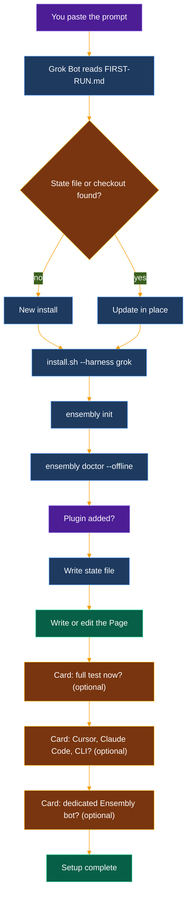

# Install with Grok Bot

Paste one short prompt into Grok Bot. It installs ensembly on its own computer, checks it, and leaves you a Page that explains what it did. Extra tools and a dedicated bot are offered one card at a time, and you can skip them.



| | |
|--|--|
| **The prompt** | Short. It clones or updates the repo, then tells Grok Bot to follow [grokbot/FIRST-RUN.md](grokbot/FIRST-RUN.md), which holds the real steps. |
| **Core (always)** | `scripts/install.sh --harness grok` (or `--update`), `ensembly init`, `ensembly doctor --offline`, the plugin, the state file, the Page. |
| **Optional** | The full test (`scripts/stranger-test.sh`, ten minutes or more), commands for Cursor, Claude Code or the plain CLI on your own computer, a dedicated Ensembly bot. A skipped or dismissed card means no, and setup goes on. |
| **State file** | `${XDG_CONFIG_HOME:-~/.config}/ensembly/grokbot-install.json`: version, commit, harnesses, plugin, test result, Page link, bot name. A re-run reads it and updates in place. |
| **Data** | Config at `${XDG_CONFIG_HOME:-~/.config}/ensembly/config.toml`. Data in `${XDG_DATA_HOME:-~/.local/share}/ensembly` (the `data_dir` line). Existing data is never moved. |
| **Never** | Asks for passwords, tokens or keys. Uses `sudo`. Deletes, moves or overwrites your files without asking. Turns on opportunity-finder. Posts anything. Creates a second Page or a second bot. |
| **Done looks like** | `ensembly doctor --offline` shows no `fail` lines, you get a Page called "Ensembly on Grok Bot", and Grok Bot says "Ensembly setup complete". |

To update later, paste the same prompt again. The optional bot is described in [ensembly-bot-template.md](ensembly-bot-template.md).

## The prompt

Copy everything in the box and paste it into a new Grok Bot chat.

```text
Set up ensembly for me on your own computer. Its source is https://github.com/thecuriousts/ensembly. Talk to me in plain words; I may not be a developer.

1. If ~/ensembly does not exist, run `git clone https://github.com/thecuriousts/ensembly ~/ensembly`.
   If it exists, check that `git -C ~/ensembly remote get-url origin` points to thecuriousts/ensembly and that `git -C ~/ensembly status --porcelain` prints nothing, then run `git -C ~/ensembly pull --ff-only`. If any of that fails, ask me with a question card before going on.
2. Read ~/ensembly/docs/grokbot/FIRST-RUN.md and follow every step in order, as one continuous run. Never skip a step. Never end your turn in the middle of setup; stop only to show me a question card.

Never ask me for a password, token or API key. Never use sudo. Never delete, move or overwrite anything of mine without asking first.
```
