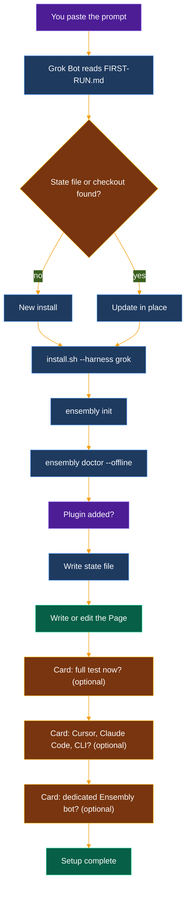

# Install with Grok Bot

Paste one short prompt into Grok Bot. It installs ensembly on its own computer, checks it, and leaves you a Page that explains what it did. Extra tools and a dedicated bot are offered one card at a time, and you can skip them.

**On your own Mac or Linux (not Grok Bot’s cloud):** you can install the `ensembly` command from [prebuilt releases](https://github.com/thecuriousts/ensembly/releases/latest) first — see [START-HERE.md](START-HERE.md) Path A — and only clone the repo if you want Cursor, Claude, or local plugin files.



| | |
|--|--|
| **The prompt** | Short. It clones or updates the repo, then tells Grok Bot to follow [grokbot/FIRST-RUN.md](grokbot/FIRST-RUN.md), which holds the real steps. |
| **Core (always)** | `scripts/install.sh --harness grok` (or `--update`), `ensembly init`, `ensembly doctor --offline`, the plugin, the state file, the Page. |
| **Optional** | The full test (`scripts/stranger-test.sh`, ten minutes or more), commands for Cursor, Claude Code or the plain CLI on your own computer, a dedicated Ensembly bot. A skipped or dismissed card means no, and setup goes on. |
| **State file** | `${XDG_CONFIG_HOME:-~/.config}/ensembly/grokbot-install.json`: version, commit, harnesses, plugin, test result, Page link, bot name. A re-run reads it and updates in place. |
| **Data** | Config at `${XDG_CONFIG_HOME:-~/.config}/ensembly/config.toml`. Data in `${XDG_DATA_HOME:-~/.local/share}/ensembly` (the `data_dir` line). Existing data is never moved. |
| **Never** | Asks for passwords, tokens or keys. Uses `sudo`. Deletes, moves or overwrites your files without asking. Turns on opportunity-finder. Posts anything. Creates a second Page or a second bot. |
| **Done looks like** | `ensembly doctor --offline` shows no `fail` lines, you get a Page called "Ensembly on Grok Bot", and Grok Bot says "Ensembly setup complete". |

To update later, paste the same prompt again. The optional bot is described in [ensembly-bot-template.md](ensembly-bot-template.md).

## The prompt

**One click:** [Open in Grok Bot](https://cursor.com/grok-bot/link/v1/prompt?text=Set%20up%20ensembly%20for%20me%20on%20your%20own%20computer.%20Its%20source%20is%20https%3A%2F%2Fgithub.com%2Fthecuriousts%2Fensembly.%20Talk%20to%20me%20in%20plain%20words%3B%20I%20may%20not%20be%20a%20developer.%20%201.%20If%20~%2Fensembly%20does%20not%20exist%2C%20run%20%60git%20clone%20https%3A%2F%2Fgithub.com%2Fthecuriousts%2Fensembly%20~%2Fensembly%60.%20%20%20%20If%20it%20exists%2C%20check%20that%20%60git%20-C%20~%2Fensembly%20remote%20get-url%20origin%60%20points%20to%20thecuriousts%2Fensembly%20and%20that%20%60git%20-C%20~%2Fensembly%20status%20--porcelain%60%20prints%20nothing%2C%20then%20run%20%60git%20-C%20~%2Fensembly%20pull%20--ff-only%60.%20If%20any%20of%20that%20fails%2C%20ask%20me%20with%20a%20question%20card%20before%20going%20on.%202.%20Read%20~%2Fensembly%2Fdocs%2Fgrokbot%2FFIRST-RUN.md%20and%20follow%20every%20step%20in%20order%2C%20as%20one%20continuous%20run.%20Never%20skip%20a%20step.%20Never%20end%20your%20turn%20in%20the%20middle%20of%20setup%3B%20stop%20only%20to%20show%20me%20a%20question%20card.%20%20Never%20ask%20me%20for%20a%20password%2C%20token%20or%20API%20key.%20Never%20use%20sudo.%20Never%20delete%2C%20move%20or%20overwrite%20anything%20of%20mine%20without%20asking%20first.). It opens Grok Bot with the prompt below already typed in the message box, not sent: read it, then press send. It needs the Grok Bot app installed and signed in, uses your primary Bot, and does nothing if you have not set one ([how deep links work](https://docs.x.ai/grok-bot/deep-links)). Newlines become spaces in the link; the steps read the same.

If the link does nothing, copy everything in the box and paste it into a new Grok Bot chat.

```text
Set up ensembly for me on your own computer. Its source is https://github.com/thecuriousts/ensembly. Talk to me in plain words; I may not be a developer.

1. If ~/ensembly does not exist, run `git clone https://github.com/thecuriousts/ensembly ~/ensembly`.
   If it exists, check that `git -C ~/ensembly remote get-url origin` points to thecuriousts/ensembly and that `git -C ~/ensembly status --porcelain` prints nothing, then run `git -C ~/ensembly pull --ff-only`. If any of that fails, ask me with a question card before going on.
2. Read ~/ensembly/docs/grokbot/FIRST-RUN.md and follow every step in order, as one continuous run. Never skip a step. Never end your turn in the middle of setup; stop only to show me a question card.

Never ask me for a password, token or API key. Never use sudo. Never delete, move or overwrite anything of mine without asking first.
```
