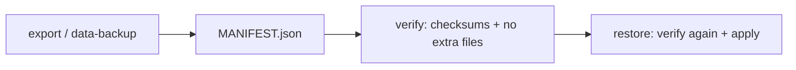

# Portable plain-text bundle

Operator-readable exports for kernel stores plus configured `[[backup.sources]]` trees. Sealed T1 pack: **`ensembly sealed-backup`**. Portable path: **`ensembly export`**, **`backup`**, **`verify`**, **`import`**, **`restore`**. Operator checklist: [no-assistant-runbook.md](no-assistant-runbook.md).

## Layout

```text
bundle/
  MANIFEST.json
  ensembly/
    ops/ops-bundle.json
    memory/ensembly-memory.json
    ledger/ledger.jsonl        # when opportunity-finder ledger exists
    views/todos.csv            # read-only; from life_state
    views/chores.csv
    views/deadlines.ics        # chore due dates only
  <section>/
    <source-name>/…            # from config; default section `shared`
```

Reserved section name: **`ensembly`** (kernel stores only). User sources must use other section names (`shared`, `work`, `life`, …).

### What `ensembly/` includes (and what it does not)

| File | SoT | Notes |
|------|-----|--------|
| `ops/ops-bundle.json` | T1 ops SQLite (`kv` + schema) | Same shape as `ensembly ops-bundle export`. Chores, deadlines, and HITL wait state live inside `kv` (e.g. `life_state`, `wait_snapshot`) — not separate tables. |
| `memory/ensembly-memory.json` | Episodic CRDT | Plain JSON on disk. |
| `ledger/ledger.jsonl` | Application ledger | Present only when the ledger file exists (`opportunity-finder` build). |

Plain **md / csv / ics** in the bundle come from **`[[backup.sources]]`** (or future derived exporters). This path does **not** replace **`pulse-pack`** (traces, optional audit tail, CRDT merge sync).

## Config

```toml
[[backup.sources]]
name = "notes"
section = "shared"   # optional; default shared
path = "~/vault/notes"
kind = "dir"
include = ["**/*"]
exclude = ["*.pem"]
```

- `section` must match `[A-Za-z0-9_-]+` (no `/` or `.`).
- Source `name` must be unique within a section; duplicates are a config error (exit 2, file + line).
- Large files are streamed for SHA-256; files over **`--max-file-mb`** (default 200) are skipped with a warning and a MANIFEST `excluded` row.

## Commands

| Command | Role |
|---------|------|
| `ensembly export --out DIR` | Write bundle; refuses non-empty `DIR` unless `--force-new-subdir` |
| `ensembly backup [--out DIR]` | Timestamped dir under `data_dir/backups` or `--out` |
| `ensembly verify BUNDLE` | Manifest paths, checksums, parse rules, **no missing/extra files** |
| `ensembly import BUNDLE [--dry-run]` | Always **verify-first** (exit 1 on failure) |
| `ensembly restore BUNDLE --sources-to DIR` | **Verify-first**, then restore sources under `DIR/<section>/<name>/…` |

Never restores config sources to their original paths without an explicit destination.

## Flow

