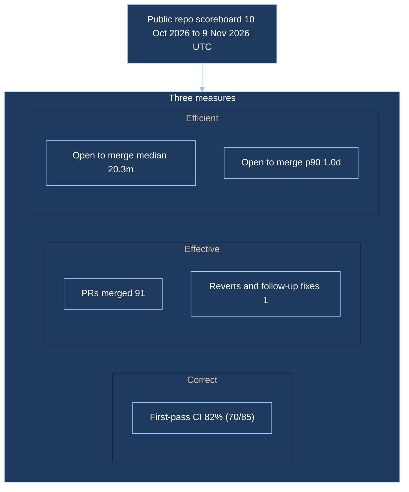

# Public engineering scoreboard

## Definitions

Window timestamps are UTC. `--since` and `--until` are inclusive calendar dates: a timestamp counts when `since 00:00 UTC <= t < until+1 day 00:00 UTC`. The default window is today UTC and the date 30 days earlier.

Owners are `p10ns11y` and `thecuriousts`. A repository is included only when `visibility` is public and `private` is false. That check runs before any name is kept. Repositories that fail it are dropped and never written down.

- **PRs merged:** pull requests whose `merged_at` falls in the window.
- **CI first-pass rate:** share of those merged pull requests whose first CI attempt on the first head commit was all green. The first head commit is the earliest pull-request commit that has at least one check run. The first attempt is the earliest `started_at` for each check name on that commit. Those conclusions count as green when they are `success`, `skipped`, or `neutral`. Any other conclusion fails the first pass. A merged pull request with no check run on any commit is omitted from the numerator and the denominator.
- **Reverts and follow-up fixes:** default-branch commits in the window whose message starts with `Revert`, `revert:`, or `This reverts commit`, plus merged pull requests titled or labelled `fix` that cite an earlier pull request (`#N` or a github.com pull URL) whose `merged_at` is earlier by at most 7 days.
- **Open-to-merge time:** median and 90th percentile of `merged_at - created_at` for merged pull requests in the window. Percentiles use linear interpolation at `q * (n - 1)`.

## Results

| Repository | PRs merged | First-pass CI | Reverts and follow-up fixes | Open to merge median | Open to merge p90 |
|---|---:|---:|---:|---:|---:|
| p10ns11y/arch-machine | 2 | 100% (2/2) | 0 | 50.2d | 87.2d |
| p10ns11y/collab-finder | 19 | 79% (15/19) | 0 | 15.4m | 1.0d |
| p10ns11y/devprofile | 6 | 100% (6/6) | 0 | 46.9m | 1.8h |
| p10ns11y/life-os | 1 | — | 0 | 1.2h | 1.2h |
| p10ns11y/p10ns11y | 1 | — | 0 | 1.0m | 1.0m |
| p10ns11y/plugins | 33 | 94% (31/33) | 0 | 16.6m | 5.3h |
| p10ns11y/skills | 3 | — | 0 | 24.4m | 4.3d |
| thecuriousts/ensembly | 26 | 64% (16/25) | 1 | 29.0m | 1.0d |
| **Total** | 91 | 82% (70/85) | 1 | 20.3m | 1.0d |

Scanned 186 public repositories; 8 had a merged pull request or a revert or follow-up fix in the window and appear above.

Over 10 Oct 2026 to 9 Nov 2026 UTC the public record shows 91 merged pull requests. First-pass CI was 82% (70/85). Open-to-merge time was 20.3m at the median and 1.0d at p90, with 1 revert and follow-up fix.

Rebuild with `python3 scripts/scoreboard/scoreboard --since 2026-10-10 --until 2026-11-09 --output docs/scoreboard.md`.
