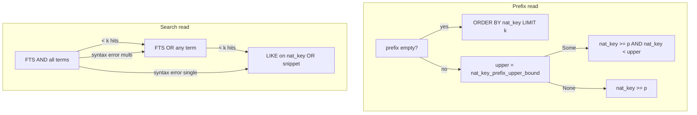

# Pulse read path (slice 1b)

Read-only retrieval over the live pulse-memory SQLite store (`memory_traces`, `memory_fts`). Ensembly never writes this DB.

## Query flow



## Prefix range

`substr(nat_key,1,len(p)) = p` scanned the table. Hot path uses the **UNIQUE** index on `nat_key`:

| Case | SQL |
|------|-----|
| `prefix == ""` | `SELECT … ORDER BY nat_key LIMIT ?` |
| normal | `WHERE nat_key >= ? AND nat_key < upper(?)` |
| all-`0xFF` tail | `WHERE nat_key >= ?` (no finite exclusive upper) |

`nat_key_prefix_upper_bound(prefix)` increments the last byte of the UTF-8 encoding; trailing `0xFF` bytes are stripped until an increment succeeds or the bound is omitted.

## Search tokens

Fixed English stopword list (`FTS_STOPWORDS` in `pulse_core.rs`). Tokens are lowercased alphanumerics; stopwords drop **only when at least one content token remains** (so `"what is what"` still searches `what`).

## Search score

Constants: `PULSE_SEARCH_RECENCY_WEIGHT` (**0.35**), `PULSE_SEARCH_RECENCY_HALF_LIFE_DAYS` (**30**).

Within each query’s candidate pool (FTS fetch capped at 256 rows; LIKE when needed):

```text
rel = min-max normalize (-bm25) over FTS hits → [0, 1]  (ties → 1.0)
recency = 0.5 ** ((t_newest - t_row) / half_life_seconds)   # half_life = 30 days
score = w * recency + (1 - w) * rel
```

- **bm25**: FTS5 on `memory_fts`; smaller bm25 ⇒ better match; normalized within the pool so it cannot be swamped by epoch-scale instants.
- **last_seen**: `unixepoch(..., 'subsec')` on mixed `Z` / offset stamps; decay vs **newest candidate**, not wall clock.
- **LIKE** rows: fixed `LIKE_RELEVANCE_SCORE` (0.15) instead of bm25.
- **AND → OR → LIKE**: OR/LIKE only when AND yields fewer than `limit` rows (or AND errors on multi-token syntax).

## CI gates (kernel tests)

- `EXPLAIN QUERY PLAN` on the prefix range query must not `SCAN` `memory_traces`.
- Prefix latency ratio `100k / 1k` rows `< 5×` (generous; catches substr regressions).
- Recall@5/10 and fresh-first accuracy vs embedded baseline (slice 1a compatible).