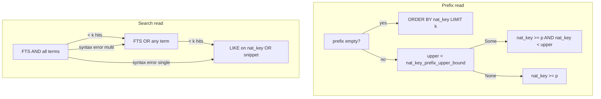

# Pulse read path (slice 1b)

Read-only retrieval over the live pulse-memory SQLite store (`memory_traces`, `memory_fts`). Ensembly never writes this DB.

## Query flow



## Prefix range

`substr(nat_key,1,len(p)) = p` scanned the table. Hot path uses the **UNIQUE** index on `nat_key`:

| Case | SQL |
|------|-----|
| `prefix == ""` | `SELECT … ORDER BY nat_key LIMIT ?` |
| normal | `WHERE nat_key >= ? AND nat_key < upper(?)` |
| all-`0xFF` tail | `WHERE nat_key >= ?` (no finite exclusive upper) |

`nat_key_prefix_upper_bound(prefix)` increments the last byte of the UTF-8 encoding; trailing `0xFF` bytes are stripped until an increment succeeds or the bound is omitted.

## Search tokens

Fixed English stopword list (`FTS_STOPWORDS` in `pulse_core.rs`). Tokens are lowercased alphanumerics; stopwords drop **only when at least one content token remains** (so `"what is what"` still searches `what`).

## Search score

Constants: `PULSE_SEARCH_RECENCY_WEIGHT` (**0.35**), `PULSE_SEARCH_RECENCY_HALF_LIFE_DAYS` (**7**), `PULSE_SEARCH_RELEVANCE_TIE_EPSILON` (**0.2**).

**Tokenize** query text on non-alphanumerics (same boundary idea as FTS5 **unicode61**), lowercase; then drop [`FTS_STOPWORDS`](../../crates/ensembly-kernel/src/pulse_core.rs) when any content token remains.

**Tiers** (strict order): FTS **AND** → FTS **OR** widen → **LIKE** last.

Within one tier:

```text
rel = min-max normalize (-bm25) over FTS hits in pool → [0, 1]  (ties → 1.0)
same revision family (`…/old` vs `…/new`) → newer `unixepoch(last_seen)` wins
else if |rel_a - rel_b| < epsilon → rank newer first
else score = w * 0.5^((t_newest - t)/7d) + (1-w) * rel
```

- **LIKE** rows: fixed low relevance (0.15); tier 3 always below FTS.
- **AND → OR → LIKE**: only when AND yields fewer than `limit` rows (or AND syntax error on multi-token input).

## CI gates (kernel tests)

- `EXPLAIN QUERY PLAN` on the prefix range query must not `SCAN` `memory_traces`.
- Prefix latency ratio `100k / 1k` rows `< 5×` (generous; catches substr regressions).
- Recall@5/10 and fresh-first accuracy vs embedded baseline (slice 1a compatible).