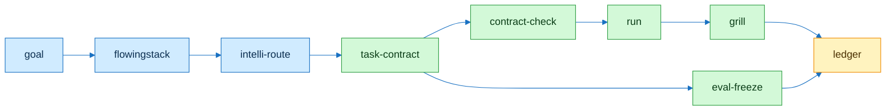
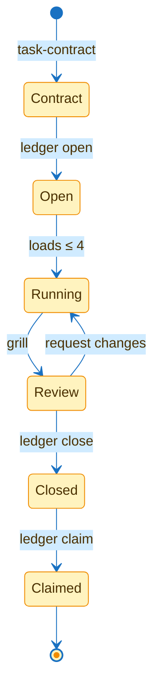
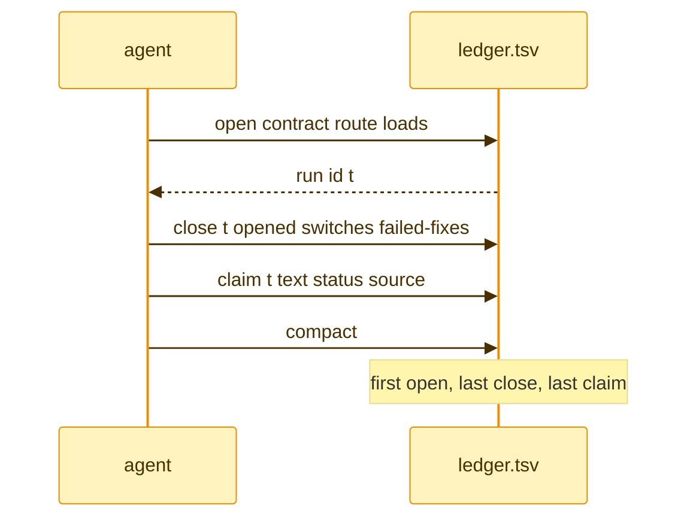

# flowingstack

```agentflow-beta LR
  src["p10ns11y/plugins at pin"] --> sync["sync-from-upstream"] --> skills["skills"]
  skills --> lint["doc-lint"] --> priv["privacy-scan"] --> ok["exit 0"]
```

## Flow



## Stages



## Ledger



```text
// Signature
R      plugin root, FLOWINGSTACK_ROOT or --root
P      pins.tsv rows: repo sha40 path dest
B      baseline rows: path rule count

// Axioms
A1  ∀ path p: p relative to R ∧ ".." ∉ p
A2  scan(f) → f ∈ R ∨ f = repo/.cursor-plugin/marketplace.json
A3  check: tree(dest) = rewrite(tree(src@sha)) ∧ NOTICE = f(P, rewrites.tsv)
A4  symlink ∨ binary → exit 1
A5  hits(path, rule) > count → all live, exit 1; row without count → exit 2
```

| Command | Exit 0 | Exit 1 | Exit 2 |
|---|---|---|---|
| `scripts/doc-lint --all` | clean | finding | absolute path |
| `scripts/privacy-scan --all [--repo-root D]` | clean | hit | — |
| `scripts/sync-from-upstream --src D [--check]` | synced or no drift | drift, binary, symlink | bad pin |
| `scripts/check --src D` | all three clean | any fail | bad args |
| `python3 -m unittest discover -s test` | green | red | — |

Every script and how they connect: [docs/flow.md](docs/flow.md).
