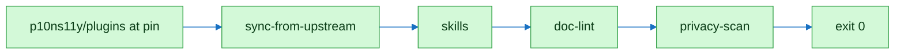
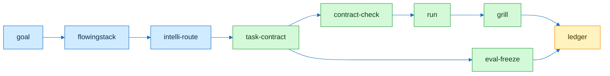
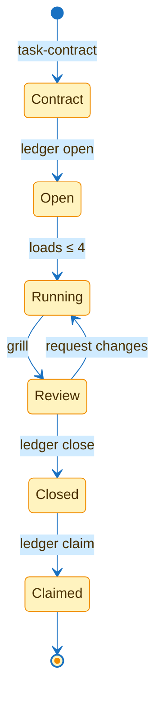
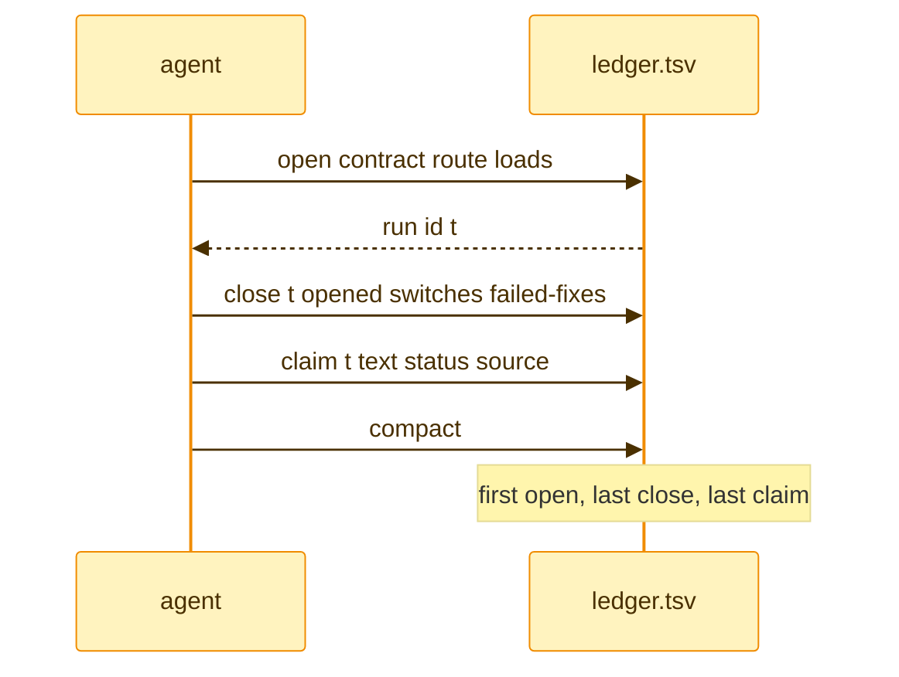

# flowingstack



## Diagrams

| Page | Shows | Image |
|---|---|---|
| [flow](docs/flow.md) | end to end flow | [svg](docs/img/flow-1.svg) |
| [states](docs/states.md) | contract, eval, ledger, review | [svg](docs/img/states-4.svg) |
| [skills](docs/skills.md) | skill graph | [svg](docs/img/skills-1.svg) |
| [connections](docs/connections.md) | scripts and files | [svg](docs/img/connections-1.svg) |
| [sequence](docs/sequence.md) | brief to ship | [svg](docs/img/sequence-1.svg) |
| [install](docs/install.md) | install and sync | [svg](docs/img/install-1.svg) |
| [harness](docs/harness.md) | Cursor, Grok Bot, other lanes | [svg](docs/img/harness-1.svg) |
| [formal](docs/formal.md) | statechart, TLC, Kani, Bend | [svg](docs/img/formal-1.svg) |

## Flow



## Stages



## Ledger



```text
// Signature
R      plugin root, FLOWINGSTACK_ROOT or --root
P      pins.tsv rows: repo sha40 path dest
B      baseline rows: path rule count

// Axioms
A1  ∀ path p: p relative to R ∧ ".." ∉ p
A2  scan(f) → f ∈ R ∨ f = repo/.cursor-plugin/marketplace.json
A3  check: tree(dest) = rewrite(tree(src@sha)) ∧ NOTICE = f(P, rewrites.tsv)
A4  symlink ∨ binary → exit 1
A5  hits(path, rule) > count → all live, exit 1; row without count → exit 2
```

| Command | Exit 0 | Exit 1 | Exit 2 |
|---|---|---|---|
| `scripts/doc-lint --all` | clean | finding | absolute path |
| `scripts/privacy-scan --all [--repo-root D]` | clean | hit | — |
| `scripts/sync-from-upstream --src D [--check]` | synced or no drift | drift, binary, symlink | bad pin |
| `scripts/check --src D` | all three clean | any fail | bad args |
| `scripts/formal-check [--bend]` | proved | counterexample | — (3 = tool missing, skip) |
| `skills/intelli-route/bin/route WHEN \| --signals JSON` | route; `task` matching formal-verification adds loads | missing map or when | bad signals |
| `python3 -m unittest discover -s test` | green | red | — |

Every script and how they connect: [docs/flow.md](docs/flow.md).

## Install

Clone the public repo and load this folder as a local Cursor plugin:

```text
git clone https://github.com/thecuriousts/ensembly/
ln -s "$PWD/ensembly/marketplaces/cursor/flowingstack" ~/.cursor/plugins/local/flowingstack
```

Reload Cursor so the skills appear. Then run `scripts/doctor --project <project>`.
After a marketplace listing exists, install `flowingstack` from there instead.

## Usage

`scripts/doctor --project .` reports missing setup. Required rows fail the run. pstack, craft, and host aliases are optional: a miss prints `optional` and does not fail. Add them with `/add-plugin pstack` and `/add-plugin craft` when you want those checks. Write host aliases in `AGENTS.md` or `docs/host-aliases.md` as `laptop-1`, `laptop-2`, or `mac-mini`.

For one change: `intelli-route` picks at most four skills, `task-contract` writes the contract, the work runs, `grill` reviews it, and `run-ledger` records the run. Freeze cases with `eval-freeze`. Ship after `scripts/check --src <upstream>` and [references/verify.md](references/verify.md) pass.

## Skills

Kernel: `task-contract`, `grill-rubric`, `run-ledger`, `eval-freeze`, `doctor`, `intelli-route`, `route-rule`.
Capture: `capture-sweep`, `capture-mail`, `capture-calendar`, `capture-chat`, `capture-pr`.
Shipped from the pin for matching house maps: `aihero-map`, `pstack-map`, `harvest`, `tomato-loop`. They stay so sync matches the pin. Skip them when those maps are unused.


## Route rule

| Layer | Path | Effect |
|---|---|---|
| shipped roles | [routing.tsv](routing.tsv) | engineering, review, docs |
| user roles | `.flowingstack/routing.tsv` or `FLOWINGSTACK_ROUTING` | same task_type replaces, new task_type adds |
| role example | [examples/house-routing.tsv](examples/house-routing.tsv) | loaded only when a user path points at it |
| shipped checks | [doctor.tsv](doctor.tsv) | required kernel checks, optional pstack, craft, aliases |
| user checks | `<project>/.flowingstack/doctor.tsv` or `FLOWINGSTACK_DOCTOR` | same name replaces, new name adds |

[route-rule](skills/route-rule/SKILL.md) runs [scripts/route-rule](scripts/route-rule). [doctor](skills/doctor/SKILL.md) reads the check table.

## Capture

| Skill | Reads |
|---|---|
| capture-sweep | mail, calendar, chat, pull requests |
| capture-mail | mail |
| capture-calendar | calendar |
| capture-chat | chat |
| capture-pr | pull requests |
