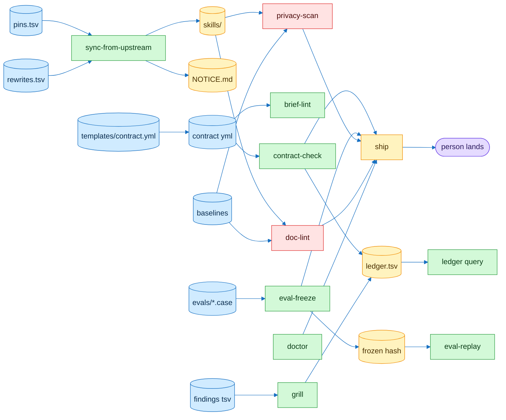

# flowingstack connections

| File | Written by | Read by |
|---|---|---|
| `pins.tsv` | person | `sync-from-upstream` |
| `rewrites.tsv` | person | `sync-from-upstream` |
| contract yml | `task-contract` | `contract-check` `ledger` `ship` |
| frozen hash | `eval-freeze lock` | `verify` `eval-replay` |
| `ledger.tsv` | `ledger` `grill` | `ledger query` |
| baselines | person | `doc-lint` `privacy-scan` |

Cylinders are files. Boxes are scripts.
