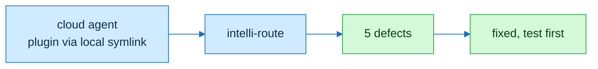

# flowingstack evidence

| Defect found by routing | Test |
|---|---|
| WHEN lookup missed vendored map.md | test_route When |
| no formal-verification signal or loads | test_route FormalSignal |
| intelli-route SKILL and README out of date | test_route Docs |
| doctor verify-skill glob missed house skills | test_doctor house verify |
| TLA2TOOLS not documented for statechart handoff | test_route Docs |

Used:
- plugins: flowingstack (installed in a cloud agent via local symlink), pstack
- skills: test-driven-development, public-host-alias, verification-before-completion, source-honesty, principle-boundary-discipline, principle-encode-lessons-in-structure, writing-skills, bot-rules, create-formal-verification-skill
- flowingstack skills the cloud agent loaded: flowingstack, intelli-route, task-contract, grill-rubric, eval-freeze, run-ledger, doctor
