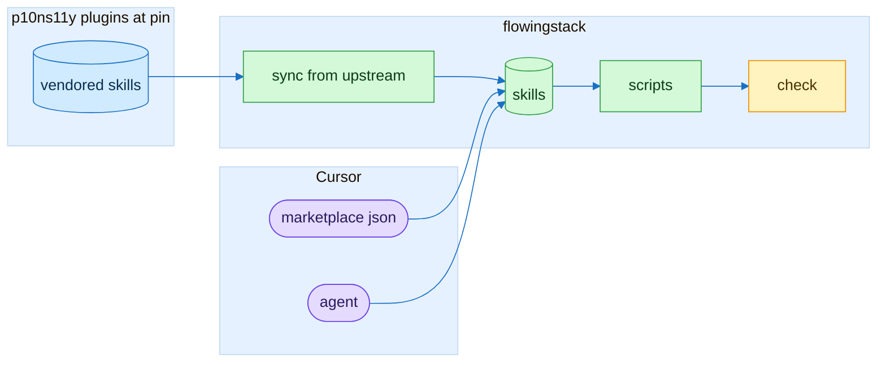
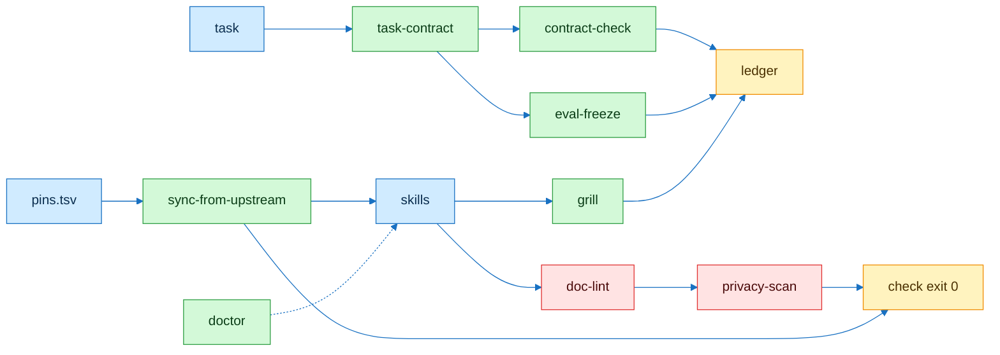

# flowingstack flow

Pele source image: [architecture](img/flow-architecture.svg)

```mermaid
%%{init: {"theme": "base", "themeVariables": {"primaryColor": "#fff3bf", "primaryBorderColor": "#f08c00", "primaryTextColor": "#4a3000", "secondaryColor": "#d0ebff", "tertiaryColor": "#d3f9d8", "lineColor": "#1971c2", "fontFamily": "Inter"}}}%%
flowchart LR
  b["brief"] --> bl["brief-lint"] --> hub["flowingstack"] --> ir["intelli-route"]
  ir --> tc["task-contract"] --> cc["contract-check"] --> lo["ledger open"]
  lo --> ef["eval-freeze lock"] --> tdd["red then green"] --> er["eval-replay"]
  er --> gr{"grill round 3 or fewer"}
  gr -->|changes| tdd
  gr -->|round 4| esc["escalate"] --> p
  gr -->|approve| lc["ledger close claim"] --> sh["ship"] --> p(["person lands"])
  cc -->|no check| x["blocked"]
  classDef src fill:#d0ebff,stroke:#1971c2,color:#0b2e4f
  classDef run fill:#d3f9d8,stroke:#2f9e44,color:#0b3d17
  classDef stop fill:#ffe3e3,stroke:#e03131,color:#4a0a0a
  classDef out fill:#fff3bf,stroke:#f08c00,color:#4a3000
  classDef who fill:#e5dbff,stroke:#7048e8,color:#2b1a5e
  class b,hub,ir src
  class bl,tc,cc,lo,ef,tdd,er,gr run
  class x,esc stop
  class lc,sh out
  class p who
```

| Node | Reads | Writes | Exit 1 when |
|---|---|---|---|
| `sync-from-upstream` | `pins.tsv` and upstream at sha | `skills/` and `NOTICE.md` | drift, binary or symlink |
| `contract-check` | contract yml | route line | route is empty |
| `brief-lint` | builder brief | missing list | no skills, snapshot or PR body rule of 120 words or fewer |
| `eval-freeze` | held-out set | frozen hash | frozen set changed |
| `grill` | findings tsv | verdict | blocker found |
| `ledger` | run rows | ledger tsv | bad row |
| `doc-lint` | docs and scripts | findings | rule hit past baseline |
| `privacy-scan` | plugin tree | hits | private string found |
| `doctor` | target project | missing list | setup gap |
| `check` | all checks | nothing | any check fails |

Blue is input. Green runs. Red blocks. Yellow is output.
