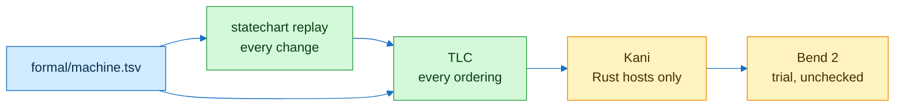
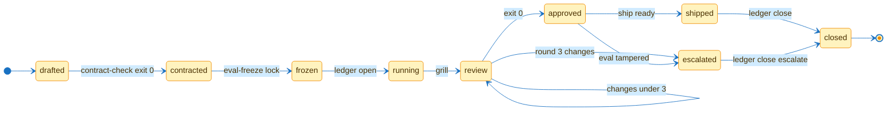

# flowingstack formal

| Property | Kind | Means | Breaks when |
|---|---|---|---|
| RoundCap | invariant | review round never above 3 | MaxRounds 4 |
| ShipFrozen | invariant | shipped implies frozen evals | Ship without frozen |
| AppendOnly | action | ledger only grows | a row is rewritten |
| EventuallyClosed | liveness | every run closes | a dead end state |

| Command | Exit |
|---|---|
| `scripts/formal-check` | 0 proved, 1 counterexample, 3 java or jar missing (skip) |
| `scripts/formal-check --bend` | 0 law holds, 1 fails, 3 bend missing (skip) |

Edges live in `formal/machine.tsv`. Tests hold the spec, this chart and the replay of the real scripts to it.
TLC: set `TLA2TOOLS` to a tla2tools.jar, or the script fetches v1.8.0 by sha256 into the user cache.
Statechart handoff: read TLC output with the pstack statechart skill.
Kani: only for hosts with Rust code, for parsers and byte handling; no Python here.
Bend 2: `formal/bend/ledger.bend` states close is idempotent; unchecked until bend runs.
