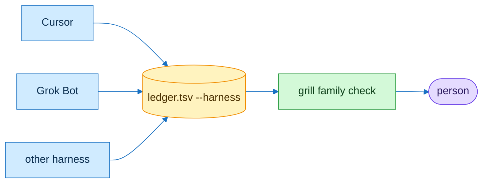

# flowingstack harness lanes

| Harness | Reads | Format note |
|---|---|---|
| Cursor | plugin skills | marketplace entry |
| Grok Bot | skills from the repo | plain SKILL.md, no plugin manifest needed |
| other harness | SKILL.md | same |

Record the lane with `ledger open --harness NAME`.
