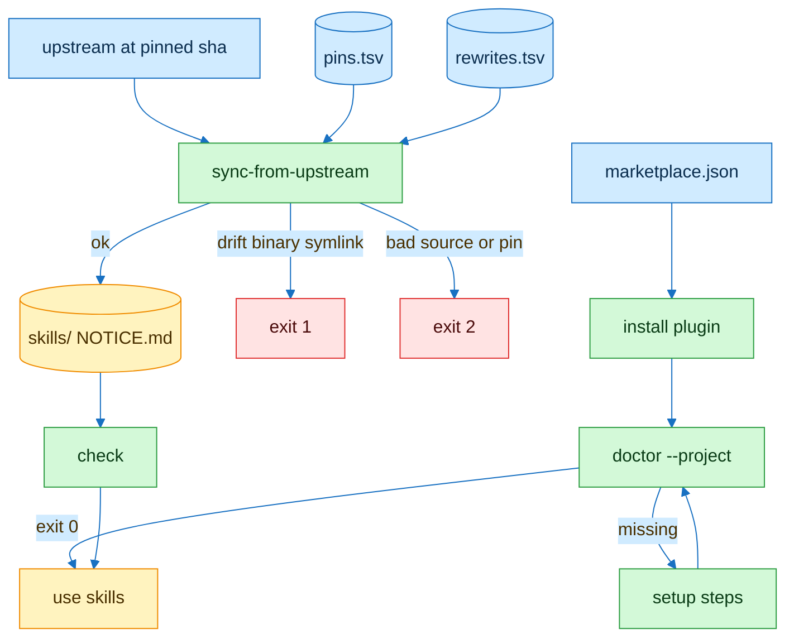

# flowingstack install and sync

| Step | Command | Fails when |
|---|---|---|
| install | Cursor marketplace | entry has fields past name source description |
| setup | `scripts/doctor --project .` | setup gap |
| sync | `scripts/sync-from-upstream` | drift, bad pin or source |
| check | `scripts/check` | any check fails |
