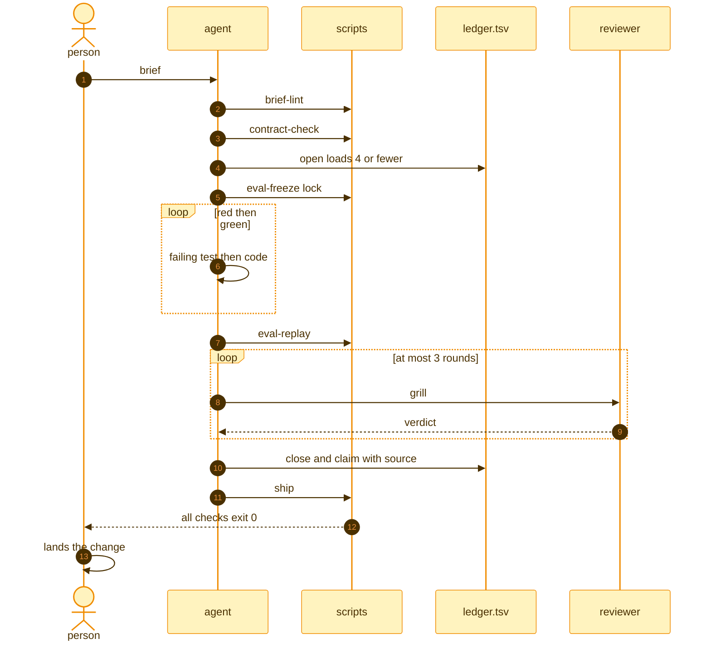

# flowingstack task sequence

| Step | Exit 0 means |
|---|---|
| brief-lint | skills snapshot and PR body rule present |
| contract-check | route found |
| eval-replay | regressions 0 |
| grill | approve |
| ship | ready for a person |
