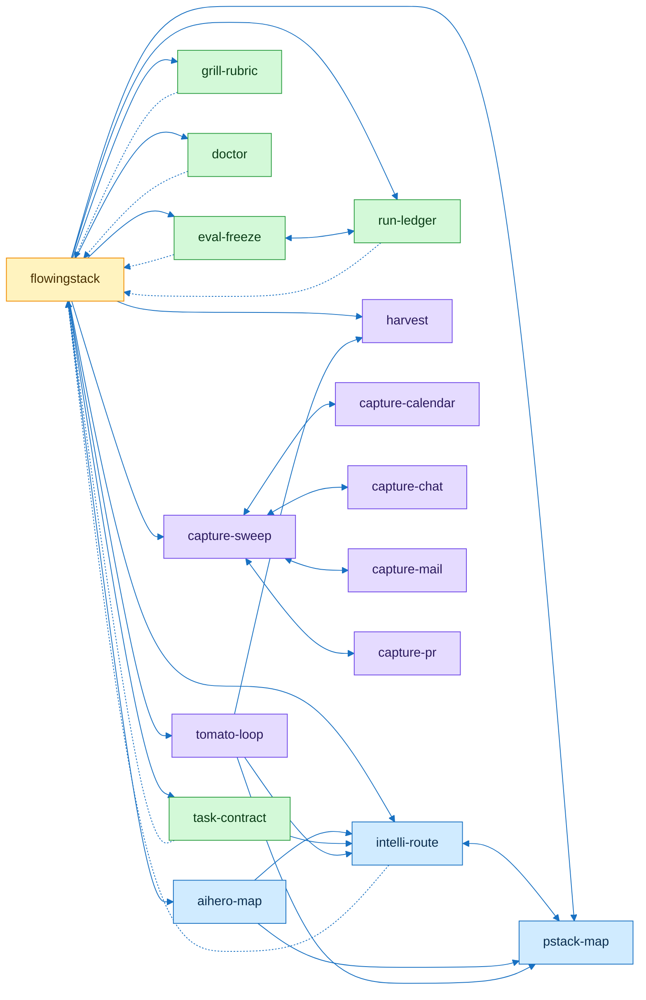

# flowingstack skill graph

| Group | Skills | Role |
|---|---|---|
| hub | flowingstack | picks the next skill |
| route | intelli-route pstack-map aihero-map | at most 4 loads |
| task | task-contract eval-freeze run-ledger grill-rubric doctor | scripted checks |
| between sessions | tomato-loop harvest capture-sweep capture-* | read only |

Edges come from skill names each SKILL.md mentions.
