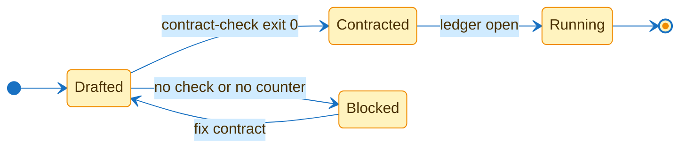
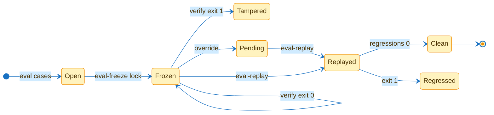
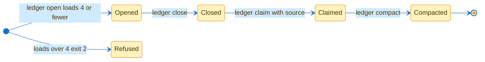
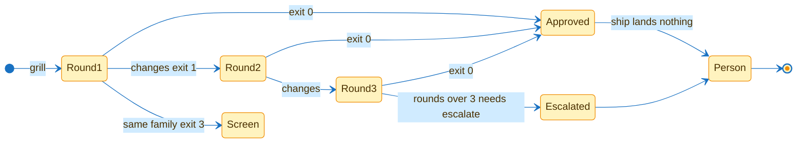

# flowingstack states

| Machine | Enter | Leave | Refuses |
|---|---|---|---|
| contract | `task-contract` | `ledger open` | empty check or counter |
| eval | `eval-freeze lock` | `eval-replay` | tamper or regression |
| ledger | `ledger open` | `ledger compact` | loads over 4 or claim without source |
| review | `grill` | person | same family or round 4 without `--escalate` |

A person lands every change.
