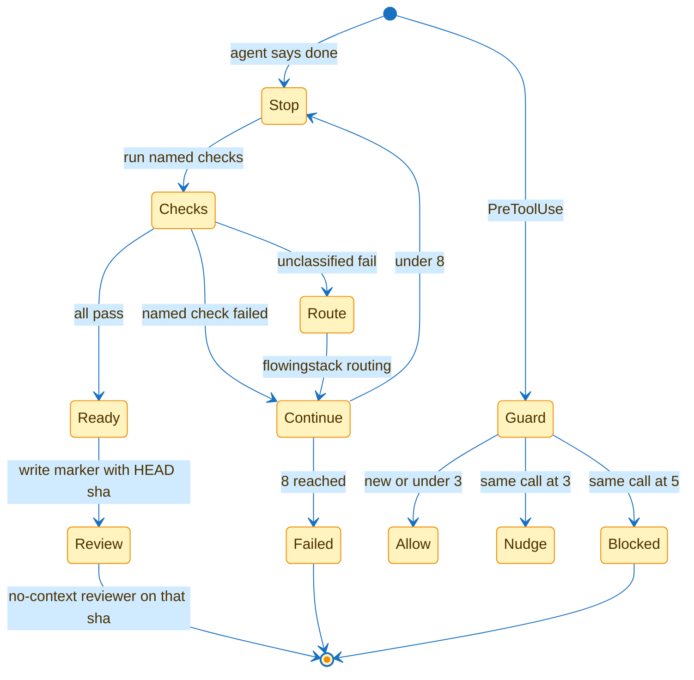

# Host decides done



The agent saying done is a claim. These hooks run the checks and a repeat counter.

| Piece | Path | Role |
|---|---|---|
| checks | `hooks/done-gate` | run the configured list |
| stop | `hooks/stop` | Claude Code `decision` `block` plus Cursor `followup_message` |
| repeat | `hooks/repeat-guard` | hash tool name and input |
| list | `hooks/checks.tsv` | tests, privacy, host-alias by default |

| Event | Fail | Bound |
|---|---|---|
| named check fail | continue with the reason | 8 then `failed-gate` |
| unclassified fail | continue and route through flowingstack | same bound |
| all pass | ready marker with HEAD sha | no-context reviewer on that sha |
| same tool 3 times | allow plus a nudge | — |
| same tool 5 times | deny and stop | queue row `blocked` when `FS_QUEUE_FILE` and `FS_QUEUE_ROW` are set |

Unclassified means no check named, missing config, unknown tool, or unknown error. `route-rule` picks the `unknown` role. The shipped lead is `unknown`. A house overlay may set `eva-emptiness` with fallback `odysseus-navigator`.

## Turn on

| Harness | File | Hook |
|---|---|---|
| Claude Code | project `.claude/settings.json` | Stop and PreToolUse command hooks |
| Cursor | project `.cursor/hooks.json` | `stop` with `loop_limit` 8 and `preToolUse` |

```json
{
  "hooks": {
    "Stop": [
      {
        "hooks": [
          {
            "type": "command",
            "command": "python3",
            "args": ["${FLOWINGSTACK_ROOT}/hooks/stop"]
          }
        ]
      }
    ],
    "PreToolUse": [
      {
        "hooks": [
          {
            "type": "command",
            "command": "python3",
            "args": ["${FLOWINGSTACK_ROOT}/hooks/repeat-guard"]
          }
        ]
      }
    ]
  }
}
```

```json
{
  "version": 1,
  "hooks": {
    "stop": [
      {
        "command": "python3 hooks/stop",
        "loop_limit": 8
      }
    ],
    "preToolUse": [
      {
        "command": "python3 hooks/repeat-guard"
      }
    ]
  }
}
```

Set `FLOWINGSTACK_ROOT` to this plugin root when the project is another tree.
Set `FLOWINGSTACK_ROUTING` to `examples/house-routing.tsv` or a local `.flowingstack/routing.tsv` to load house rows.
Leave the user Claude Code and Cursor config files untouched unless you want the hooks on every project.
