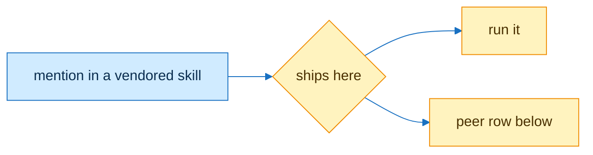

# peers

| file | mention | when missing |
|---|---|---|
| skills/aihero-map/references/map.md | `bin/steer-log` | install the steer-log plugin; without it, hold the card |
| skills/intelli-route/AGENTS.md | `references/map.md` | read skills/pstack-map/references/map.md |
