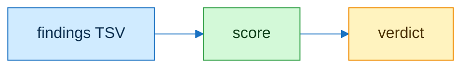

# rubric

| id | criterion | weight |
|---|---|---|
| R1 | correct on the contract check | 30 |
| R2 | test seen red before source | 20 |
| R3 | blast radius named and checked | 15 |
| R4 | privacy scan clean | 15 |
| R5 | scope matches contract | 10 |
| R6 | writing rule and doc-lint clean | 10 |

| severity | factor |
|---|---|
| blocker | 0, the verdict decides |
| major | 1.0 |
| minor | 0.3 |

| status | until |
|---|---|
| weights R1 to R6, threshold 80, factors: provisional | reviewer noise floor measured in the first real-work evaluation |
