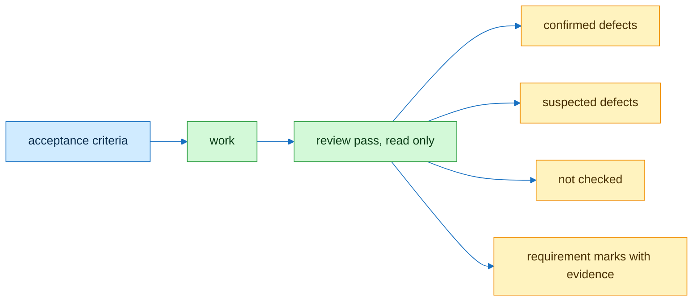

# verify



```text
// Signature
Q        requirements, written done before work starts
mark(q)  Verified | Not met | Not checked
e(q)     evidence: command and output, source, or calculation

// Axioms
V1  Q = ∅ → no work starts
V2  review pass ≠ work pass; reviewer lists confirmed, suspected, not checked apart
V3  ∀ q ∈ Q: mark(q) given ∧ (mark(q) = Not checked ∨ e(q) ≠ ∅)
V4  claim without its arithmetic or test → Not checked
V5  review is read only: no publish, send or edit
```

Source: X article Meet Your Cheapest Employee, 26 Oct 2026, prompt 4, skill 2 and section 7.
