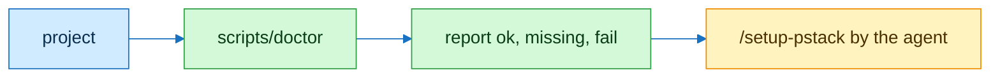

# doctor

## Flow



## Contract

```text
// Signature
P        project dir
D        plugin dirs
M        P/.cursor/rules/pstack-models.mdc

// Axioms
A1  doctor reads P and D, writes nothing
A2  M missing → report /setup-pstack; ¬ write M
A3  disk ≥ 70% → fail disk
A4  CI status ∋ failure ∨ billing → fail ci-health
A5  exit 0 ⟺ no missing ∧ no fail
```

| Item | ok when |
|---|---|
| model-rule | M exists |
| agents-md | P/AGENTS.md exists |
| ci | P/.github/workflows holds a workflow |
| verify-skill | a skill named verify exists |
| hooks | P/.cursor/hooks.json exists |
| aliases | AGENTS.md or docs/host-aliases.md names laptop-1 or mac-mini |
| pstack, craft | found in D |
| disk | below 70% |

## Checks

| Command | Expect |
|---|---|
| `scripts/doctor --project P --plugins-dir D` | report, exit 0 or 1 |
| `scripts/doctor --project P --init` | `next: /setup-pstack`, tree unchanged |
| `python3 -m unittest discover -s test -p 'test_doctor*'` | green |

## Notes

Setup runs through the pstack command /setup-pstack in the agent. Doctor never writes pstack-models.mdc or any setup file.
