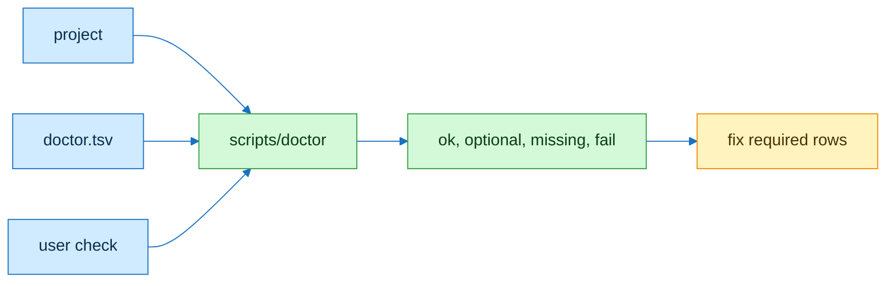

# doctor

## Flow



## Contract

```text
// Signature
P        project dir
D        plugin dirs
B        shipped doctor.tsv
U        user checks
key      name

// Axioms
A1  doctor reads P and D, writes nothing
A2  rows start as B
A3  each U row replaces the same key or appends a new key
A4  U missing → rows = B
A5  exit 0 ⟺ no required miss ∧ no fail
A6  optional miss prints optional and does not fail
A7  disk used ≥ arg on a required disk row → fail disk
A8  CI status ∋ failure ∨ billing → fail ci-health
A9  model-rule, aliases, pstack, craft are optional in B
A10 model-rule fix names /setup-pstack; doctor does not write that file
```

| kind | ok when |
|---|---|
| file | arg exists under P |
| glob | arg glob hits under P |
| verify | `verify`, `grill-rubric`, `references/verify.md`, `verification-before-completion`, `create-verification-skill`, or `maintain-verification-skill` in P or D |
| regex | arg matches `AGENTS.md` or `docs/host-aliases.md` |
| plugin | arg is installed in D |
| disk | used percent below arg |

| Layer | Path | Loaded |
|---|---|---|
| shipped | [doctor.tsv](../../doctor.tsv) | always |
| env | `FLOWINGSTACK_DOCTOR` | when the path is a file |
| local | `<project>/.flowingstack/doctor.tsv` | when env is unset and the file exists |
| example | [examples/house-doctor.tsv](../../examples/house-doctor.tsv) | only when a user path points at it |

| Change | How |
|---|---|
| add | new `name` |
| tweak | same `name`, new required, kind, arg, or fix |

## Checks

| Command | Expect |
|---|---|
| `scripts/doctor --project P --plugins-dir D` | report, exit 0 or 1 |
| `scripts/doctor --project P --init` | `next:` first required fix or `next: none`, tree unchanged |
| `bin/flowingstack-doctor` | versions, harness and plugin state, exit 0, 1 or 2 |
| `bin/flowingstack-doctor --offline` | same, latest-tag lookup skipped |
| `python3 -m unittest discover -s test -p 'test_doctor*'` | green |

## Rails mode

`bin/flowingstack-doctor` runs `scripts/doctor --rails`. It reads, never writes.

| Line | Meaning |
|---|---|
| `flowingstack X.Y.Z` | version in `.cursor-plugin/plugin.json` |
| `manifest claude X.Y.Z` | `.claude-plugin/plugin.json`, must match |
| `tool NAME V` or `missing` | git, python3, claude, cursor-agent |
| `harness claude-code KEY V SCOPE` | entry in `$CLAUDE_CONFIG_DIR/plugins/installed_plugins.json` |
| `harness cursor flowingstack V` | plugin under `~/.cursor/plugins` |
| `latest flowingstack--vX.Y.Z`, `none`, `offline`, `skipped` | newest release tag on the remote |

| Exit | When |
|---|---|
| 0 | healthy, including offline and missing optional tools |
| 1 | manifests disagree, `installed_plugins.json` unreadable, or an install path is gone |
| 2 | `.cursor-plugin/plugin.json` unreadable, or bad arguments |

## Notes

`FLOWINGSTACK_DOCTOR` selects the user file when that path is a file. Otherwise `<project>/.flowingstack/doctor.tsv` does. A missing path leaves the shipped checks unchanged.
A new name adds a check. The same name replaces that shipped check.
pstack, craft, and host aliases are optional on a fresh install. /setup-pstack is the optional model-rule fix when that plugin is in use. Doctor writes no setup file.
