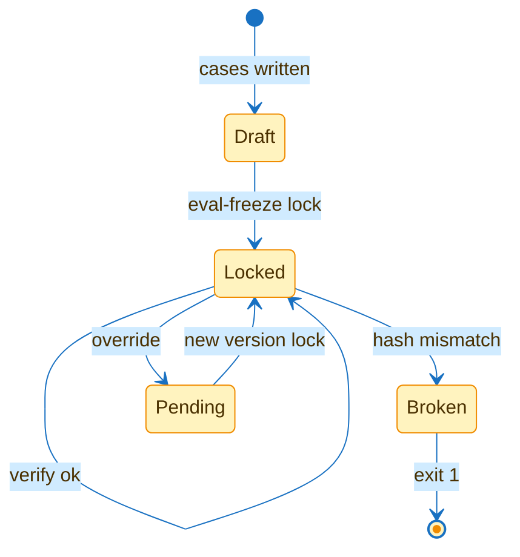

# eval-freeze

## Flow



## Contract

```text
// Signature
F        frozen dir with FROZEN.sha256
c        case: id area bug_class time contract expected
h(c)     sha256 of case file

// Axioms
A1  lock(F) → ∀ c ∈ F: c.area ∧ c.bug_class ∧ c.time ≠ ∅
A2  verify(F) = 0 ⟺ ∀ c: h(c) = lock(c) ∧ set(F) = set(lock)
A3  ∀ f ∈ F: diff(base, f) ≠ ∅ → exit 1
A4  override → F/pending/id.case ∧ F unchanged
A5  id ∈ F ∪ pending → override refused
A6  replay(F, S) = 0 ⟺ A2 ∧ ∀ c ∈ F ∪ pending: S(c.contract) = c.expected
```

| Command | Exit 0 | Exit 1 | Exit 2 |
|---|---|---|---|
| `eval-freeze lock F` | locked | — | A1 broken |
| `eval-freeze verify F` | A2 | mismatch or unlocked | — |
| `eval-freeze override F --id --contract --expected --area --bug_class --time` | pending case | — | A5 |
| `eval-freeze split F --by area` | counts | — | — |
| `eval-replay F --skill S` | A6 | regression or A2 broken | S not executable |
| `eval-freeze diff-check --repo R --base B F` | no frozen change | A3 | — |

## States

| State | Meaning |
|---|---|
| Draft | cases, no lock |
| Locked | hashes match |
| Pending | override waits for the next version |
| Broken | case edited, added or removed |

## Checks

| Command | Expect |
|---|---|
| `python3 -m unittest discover -s test -p 'test_eval*'` | green |

## Notes

Misroute runs from run-ledger enter as overrides. The router table changes only when a held-out version routes better.
