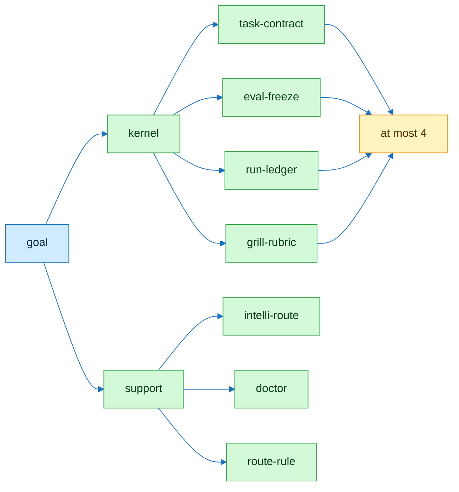

# flowingstack

## Flow



## Contract

```text
A1  load(flowingstack) → load ≤ 4 more from the table
A2  default path: task-contract, eval-freeze, run-ledger, grill-rubric
A3  support: intelli-route, doctor, route-rule
A4  route-rule shipped roles: engineering, review, docs
A5  a user file adds a row or replaces one key
A6  engineering PR: task-contract, grill-rubric, references/verify.md
A7  craft and ub-mode load only when installed
A8  tomato-loop, harvest, capture-*, pstack-map, aihero-map stay off the default path
```

| Need | Load |
|---|---|
| route a goal | `intelli-route` |
| role for a task | `route-rule` |
| write input, output, check | `task-contract` |
| freeze or replay evals | `eval-freeze` |
| log a run or claim | `run-ledger` |
| review before merge | `grill-rubric` |
| setup or CI health | `doctor` |
| engineering PR | `task-contract`, `grill-rubric`, `references/verify.md` |
| optional focus block | `tomato-loop` |
| optional evidence row | `harvest` |
| optional capture | `capture-sweep`, `capture-mail`, `capture-calendar`, `capture-chat`, `capture-pr` |
| optional maps | `pstack-map`, `aihero-map` |
| optional extras when installed | `craft`, `ub-mode` |

## Checks

| Command | Expect |
|---|---|
| `python3 -m unittest discover -s test -p 'test_skills*'` | green |

## Notes

House desks stay in [examples/house-routing.tsv](../../examples/house-routing.tsv) and load only when a user path points there.
Shipped checks stay in [doctor.tsv](../../doctor.tsv). A project file can add or replace one check.
