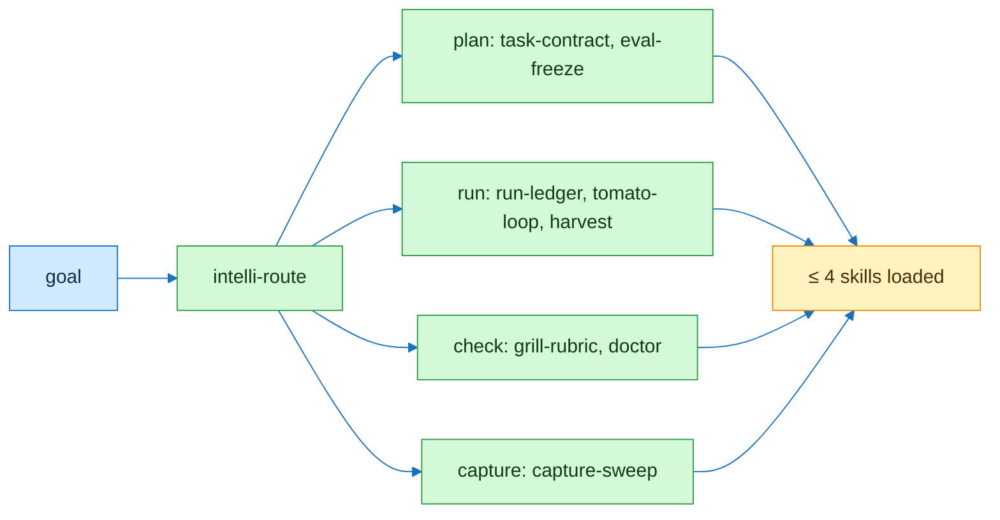

# flowingstack

## Flow



## Contract

```text
A1  load(flowingstack) → load ≤ 4 more, chosen below
A2  unsure → intelli-route
```

| Need | Load |
|---|---|
| route a goal | `intelli-route` |
| write input, output, check | `task-contract` |
| freeze or replay evals | `eval-freeze` |
| log a run or claim | `run-ledger` |
| review before merge | `grill-rubric` |
| setup or CI health | `doctor` |
| one focus block | `tomato-loop` |
| block evidence to a row | `harvest` |
| read mail, calendar, chat, PRs | `capture-sweep`, `capture-mail`, `capture-calendar`, `capture-chat`, `capture-pr` |
| house skill map | `pstack-map`, `aihero-map` |

## Checks

| Command | Expect |
|---|---|
| `python3 -m unittest discover -s test -p 'test_skills*'` | green |
