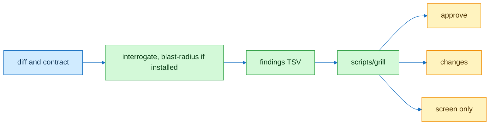

# grill-rubric

## Flow



## Contract

```text
// Signature
W        weights from references/rubric.md, fixed
F        findings: rubric id, severity
s        100 − Σ W(i) · factor(sev), floored, ≥ 0

// Axioms
A1  same F, same W → same s
A2  author = reviewer → verdict = screen
A3  blocker ∈ F → verdict ≠ approve
A4  verdict = approve ⟺ s ≥ 80 ∧ A2, A3 hold false
A5  id ∉ W ∨ sev ∉ {blocker, major, minor} → exit 2
```

| Verdict | Exit |
|---|---|
| approve | 0 |
| changes | 1 |
| bad input | 2 |
| screen | 3 |

## Checks

| Command | Expect |
|---|---|
| `scripts/grill --findings test/fixtures/grill/findings.tsv --author coder --reviewer grill` | `score=65 verdict=changes` |
| `python3 -m unittest discover -s test -p 'test_grill*'` | green |

## Notes

Self-review screens and never approves. The rubric hash in the output ties a score to one rubric version.
