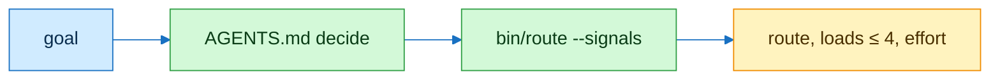

# intelli-route

## Flow



## Contract

```text
// Axioms
A1  rules = AGENTS.md, routes = manifest.json, both vendored
A2  |loads| ≤ 4
A3  house row of AGENTS.md → skills/pstack-map/references/map.md
A4  task matches manifest signal formal-verification → loads statechart, create-formal-verification-skill, maintain-formal-verification-skill, create-verification-skill
```

## Checks

| Command | Expect |
|---|---|
| `skills/intelli-route/bin/route --signals '{}'` | `{"effort": "high", "reason": "normal feature"}` |
| `skills/intelli-route/bin/route "otherwise, for non-trivial engineering"` | route light, playbook from map.md |
| `skills/intelli-route/bin/route --signals '{"task": "model-check the ledger"}'` | signal formal-verification, four loads |

## Notes

Read AGENTS.md first.
Statechart handoff: set `TLA2TOOLS` to a tla2tools.jar, or let `scripts/formal-check` fetch the pinned jar. See [formal](../../docs/formal.md).
