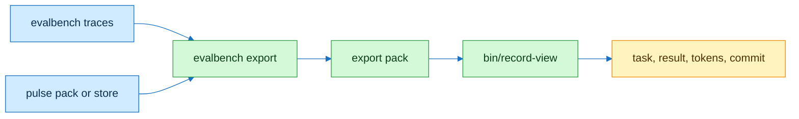

# record-view

## Flow



## Contract

```text
// Signature
X        export pack, format ensembly-export-v1
R        runs in X, each with rows
r.first  rows of r with attempt 1

// Axioms
A1  record-view reads X, writes nothing
A2  one line per run: run id, dataset hash, tasks, first_pass, score, median tokens, models
A3  one line per row: task id, pass or fail, tokens in + out, model, prompt
A4  exit 1 ⟺ some r: first_pass ≠ count of passing r.first, or tasks ≠ |r.first| + missing
A5  exit 2 ⟺ X unreadable, wrong format, commit not 40 hex, or no runs
```

| Line | Meaning |
|---|---|
| `commit SHA` | commit the traces were recorded at |
| `pulse pack_sha256 H traces N` or `pulse none` | canonical pulse pack in the export |
| `run ID dataset H tasks N first_pass K score S median_tokens M models IDS` | one evalbench run |
| `task ID pass\|fail tokens T in I out O model M prompt P` | one trace row |

## Checks

| Command | Expect |
|---|---|
| `bin/record-view X` | the lines above, exit 0, 1 or 2 |
| `python3 -m unittest discover -s test -p 'test_record_view*'` | green |

## Notes

Make an export with `evalbench export --tasks DIR --traces T --commit SHA [--pulse-pack P | --pulse-db DB --exported-at T --host H] --out X`. A pulse store is opened read-only. The numbers are whatever the traces hold: a synthetic replay stays synthetic.
