# route-rule

## Flow

```mermaid
%%{init: {"theme": "base", "themeVariables": {"primaryColor": "#fff3bf", "primaryBorderColor": "#f08c00", "primaryTextColor": "#4a3000", "lineColor": "#1971c2", "fontFamily": "Inter"}}}%%
flowchart LR
  t["task"] --> r["route-rule --task"]
  b["routing.tsv"] --> r
  u["user row"] --> r
  r -->|match| l["route to role"]
  r -->|no match exit 2| c["ask engineering"]
  classDef src fill:#d0ebff,stroke:#1971c2,color:#0b3d6e
  classDef act fill:#d3f9d8,stroke:#2f9e44,color:#14532d
  classDef out fill:#fff3bf,stroke:#f08c00,color:#4a3000
  class t,b,u src
  class r act
  class l,c out
```



## Contract

```text
// Signature
T        task text
B        shipped routing.tsv
U        user rows
key      task_type

// Axioms
A1  rows start as B
A2  each U row replaces the same key or appends a new key
A3  U missing → rows = B
A4  match keeps the row with the most keyword hits
A5  a tie keeps the earlier row
A6  no hit → exit 2, ask engineering
A7  B roles are engineering, review, docs, unknown
A8  --table reads that file alone and does not merge U
```

| Layer | Path | Loaded |
|---|---|---|
| shipped | [routing.tsv](../../routing.tsv) | always, unless `--table` |
| env | `FLOWINGSTACK_ROUTING` | when the path is a file |
| local | `.flowingstack/routing.tsv` in cwd | when env is unset and the file exists |
| example | [examples/house-routing.tsv](../../examples/house-routing.tsv) | only when a user path points at it |

| Change | How |
|---|---|
| add | new `task_type` |
| tweak | same `task_type`, new lead or keywords |

| Command | Out | Exit |
|---|---|---|
| `scripts/route-rule --task "x"` | type role rule | 0 or 2 |
| `scripts/route-rule --list` | merged table | 0 or 2 |
| `--json` | one JSON object | same |
| bad table | one line | 2 |

Script [route-rule](../../scripts/route-rule)

## Checks

| Command | Expect |
|---|---|
| `python3 -m unittest discover -s test -p 'test_route_rule*'` | green |

## Notes

Env selects the user file when that path is a file. Otherwise the cwd file does. A missing path leaves the shipped rows unchanged.
A new task_type adds a row. The same task_type replaces that shipped row.
The house example keeps one team's desks. A fresh install does not load it.
