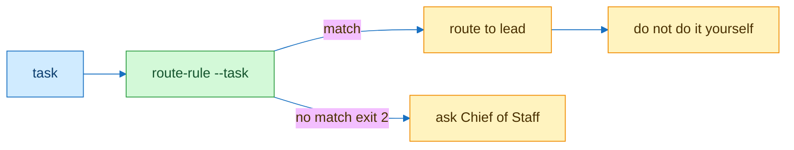

# route-rule

| Command | Out | Exit |
|---|---|---|
| `scripts/route-rule --task "x"` | type lead rule | 0 or 2 |
| `scripts/route-rule --list` | table | 0 or 2 |
| `--json` | one JSON object | same |
| bad table | one line | 2 |

Table [routing.tsv](../../routing.tsv) Script [route-rule](../../scripts/route-rule)
No pre-turn hook runner exists so the bot loads this skill first
Irreversible yes goes to Chief of Staff in the 1:1
