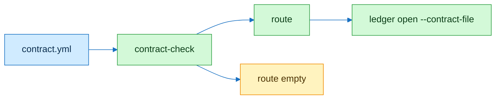

# task-contract

## Flow



## Contract

```text
// Signature
C        contract: id input output check reversible blast counter
k(C)     check kind before the first colon
R        bug | feature | refactor | perf | eval | empty

// Axioms
A1  C.id = ∅ ∨ C.input = ∅ ∨ C.output = ∅ ∨ C.counter = ∅ → exit 2
A2  C.check = ∅ → route = empty ∧ exit 1
A3  k = metric ∧ no number → route = empty
A4  route = empty → route ≠ light
A5  ledger row cites C.id
A6  C.counter names one metric that must not regress
```

| check kind | route |
|---|---|
| `test:` | bug |
| `acceptance:` | feature |
| `unchanged:` | refactor |
| `metric:` with a number | perf |
| `heldout:` | eval |
| none | empty |

## Checks

| Command | Expect |
|---|---|
| `scripts/contract-check test/fixtures/contract/bug.yml` | `route=bug`, exit 0 |
| `scripts/contract-check test/fixtures/contract/nocheck.yml` | `route=empty`, exit 1 |
| `scripts/brief-lint test/fixtures/brief/nopr.md` | `brief missing: pr-body`, exit 1 |
| `python3 -m unittest discover -s test -p 'test_contract*'` | green |

## Notes

Template in `templates/contract.yml`. Reversibility and blast radius feed effort in intelli-route.
