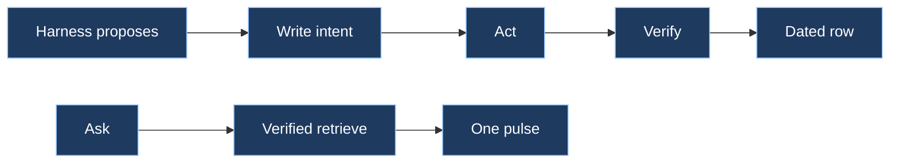

# ensembly

Shared Grok Bot plugin. Skills, not a bot: every bot on the account can load the record layer.



## Spec

| Law | Do | Do not |
|-----|----|--------|
| One owner per fact | One writer owns each fact. Replicas are not a second source of truth. | Two bots updating the same fact, or treating an import as canonical |
| Dated rows | Every write carries event time and source | Undated claims, or silent overwrites |
| Intent, then act, then verify | Record the intent and an idempotency key, act, read the row back | Act first and log the attempt as if it already happened |
| Idempotency keys | The same request again is a no-op | A second row for the same intended write |
| Verified retrieve | Hand the next agent one dated, sourced pulse | Dump a transcript, archive, or averaged story |

This plugin does not add a Model Context Protocol server. The optional kernel binary already exposes read and record tools when you build it. Skills work without that binary.

It does not replace `pulse-memory` (how memory is admitted) or `flowingstack` (how a task is contracted and reviewed).

## Skills

| Load | When |
|------|------|
| `ensembly` | First. Picks the next skill. |
| `record-layer` | Writing or changing a shared fact |
| `verified-retrieve` | Reading memory or building context for another agent |

## Install

After this folder is on the default branch of [thecuriousts/ensembly](https://github.com/thecuriousts/ensembly):

1. In Grok Bot, add the GitHub marketplace `thecuriousts/ensembly` if it is not already added. The repo catalog is `.cursor-plugin/marketplace.json`.
2. Install the `ensembly` plugin (source: `marketplaces/grokbot/ensembly`).
3. In any bot, load the `ensembly` skill, then `record-layer` or `verified-retrieve`.

To try the folder before a marketplace refresh: download `marketplaces/grokbot/ensembly` and install that folder as a local plugin.

Public marketplace listing and Publisher Terms are a separate step. This plugin can be used from the GitHub catalog without that form.

## Check

```bash
python3 test/check_plugin.py
```
