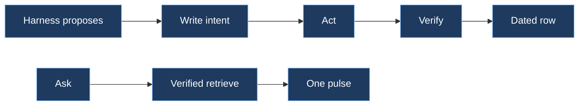

# ensembly

Shared Grok Bot plugin. Skills, not a bot: every bot on the account can load the record layer.



## Spec

| Law | Do | Do not |
|-----|----|--------|
| One owner per fact | One writer owns each fact. Replicas are not a second source of truth. | Two bots updating the same fact, or treating an import as canonical |
| Dated rows | Every write carries event time and source | Undated claims, or silent overwrites |
| Intent, then act, then verify | Record the intent and an idempotency key, act, read the row back | Act first and log the attempt as if it already happened |
| Idempotency keys | The same request again is a no-op | A second row for the same intended write |
| Verified retrieve | Hand the next agent one dated, sourced pulse | Dump a transcript, archive, or averaged story |

This plugin does not add a Model Context Protocol server. The optional kernel binary already exposes read and record tools when you build it. Skills work without that binary.

It does not replace `pulse-memory` (how memory is admitted) or `flowingstack` (how a task is contracted and reviewed).

## Skills

| Load | When |
|------|------|
| `ensembly` | First. Picks the next skill. |
| `record-layer` | Writing or changing a shared fact |
| `verified-retrieve` | Reading memory or building context for another agent |

## Install

After this folder is on the default branch of [thecuriousts/ensembly](https://github.com/thecuriousts/ensembly):

1. In **Grok Bot**, open marketplace settings and add the GitHub marketplace `thecuriousts/ensembly`. The catalog file in the repo is `.cursor-plugin/marketplace.json`.
2. Install the **ensembly** plugin (source path: `marketplaces/grokbot/ensembly`).
3. Restart or reload Grok Bot if it does not show the new skills immediately.
4. In any bot chat, type **`/ensembly`** or load the **ensembly** skill from the skill list.

**Cursor (optional):** add the same marketplace in Cursor, install **ensembly**, then reload the window.

**Try without waiting for marketplace refresh:** download the folder `marketplaces/grokbot/ensembly` from GitHub and install it as a **local plugin**.

**CLI (optional):** install the `ensembly` command from [prebuilt releases](https://github.com/thecuriousts/ensembly/releases/latest) or build from source — see the repo [START-HERE](https://github.com/thecuriousts/ensembly/blob/master/docs/START-HERE.md) guide.

Public Cursor marketplace listing and Publisher Terms are a separate step. This plugin can be used from the GitHub catalog without that form.

## Usage

1. Load **`ensembly`** first in a chat. It tells you whether to open **`record-layer`** (writes) or **`verified-retrieve`** (reads).
2. For a **write**, follow **`record-layer`**: state intent and an idempotency key, perform the action, then verify the row matches what you intended.
3. For a **read**, follow **`verified-retrieve`**: fetch one dated pulse for the next step instead of pasting a long transcript.
4. When you use the optional CLI, run **`ensembly doctor --offline`** to confirm the plugin and tools look healthy.

## Configuration

| Setting | What it does |
|---------|----------------|
| Marketplace source | `thecuriousts/ensembly` on GitHub — no API keys for the plugin itself |
| Skills | Under `./skills/` in this folder; only relative paths, no `..` |
| MCP | **Not included.** To attach kernel tools in Grok Build, install **`ensembly-mcp`** from the repo separately (see repo docs) |
| Updates | Pull the repo or refresh the marketplace entry; bump follows the plugin `version` field |

## Check

```bash
python3 test/check_plugin.py
python3 -m unittest discover -s test
```