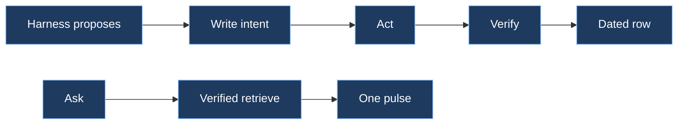

# ensembly

Harnesses propose. The record layer authorizes, claims, and completes. Memory beside it may advise. It does not decide.

## Spec

| Law | Meaning |
|-----|---------|
| One owner per fact | One writer is canonical for each fact. An imported copy is not a second source of truth. |
| Dated rows | A write without event time and source is a hypothesis, not a record. |
| Intent, then act, then verify | Write what you mean to change and its idempotency key, then act, then read the row back. |
| Idempotency keys | Repeating the same request must not create a second fact. |
| Verified retrieve | Give the next agent one dated, sourced pulse. Do not dump an archive. |

Public rows use host aliases only: `laptop-1`, `laptop-2`, `mac-mini`. Call the Grok Bot computer the canonical host in prose. Never write a real hostname, username, home path, or machine id.

## Next skill

| Situation | Load |
|-----------|------|
| Writing, changing, owning, committing, or superseding a fact | `record-layer` |
| Reading memory, pulsing, prefetching, or assembling context | `verified-retrieve` |

If the optional kernel CLI or `ensembly-mcp` is already present, use it. Do not add a new server from this plugin. If it is absent, follow the same laws against the store you do have.

Skip this plugin for a one-line typo that does not change a shared fact.
